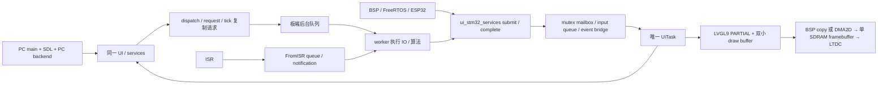

# 目录与平台架构

最终工程为 `D:/Postgraduate_Program/111AAALearn_Lab/111AAABikeComputer/Software/Lvgl_Project`，应用版本 1.5.1。PC 与 STM32 使用同一份 `src/ui`、`src/services`、字体和必要静态资源。页面布局、动效、动作、导航算法未重新设计。

```text
Lvgl_Project/
├─ CMakeLists.txt                 UI_PLATFORM=PC | STM32；C11
├─ cmake/
│  ├─ ui_sources.cmake            共用 UI/services/仓库字体源码清单
│  ├─ pc.cmake                    PC 可执行程序、HAL、SDL、测试、可选POSIX FreeRTOS
│  ├─ stm32.cmake                 HAL-free 静态库 bike_ui_stm32
│  └─ toolchains/armclang*.cmake   Cortex-M7 / AC6 / hard-float
├─ config/pc/lv_conf.h            保留原模拟器绘制配置
├─ config/stm32/lv_conf.h         LVGL9；LV_OS_NONE；关闭桌面驱动/FS/TinyTTF/demo
├─ lv_conf.h                     兼容原 PC include 入口
├─ src/main.c、src/hal/            仅 PC 入口与 SDL HAL
├─ src/platform/
│  ├─ ui_platform_internal.h      有界的内部平台策略
│  ├─ pc/                         文件、日期、天气演示、mock、路线回放、默认PC锁
│  └─ stm32/
│     ├─ ui_stm32_services.*      板端正式数据/命令/输入/完成边界
│     ├─ ui_stm32_startup.*       聚合原 backend；一次启动；UiTask handler及诊断
│     ├─ ui_stm32_display.*       LVGL9 PARTIAL及flush所有权
│     ├─ ui_stm32_input.*         从同一触摸缓存读 pointer indev
│     └─ ui_stm32_defaults.c      无硬件默认无效；无模拟成功或自旋锁
├─ src/services/                 邮箱、纯算法、read_at；不含 WinHTTP/FatFs/HAL
├─ src/ui/                       同一套UI；runtime上下文检查；memory段属性
├─ tests/ui_stm32_board_test.c    仅 host 契约测试，不进入生产 STM32 库
└─ tools/audit_board_ready.py     源清单、ARM ELF、原子/阻塞/LVGL调用审计
```



`UI_PLATFORM` 通过源文件选择隔离操作系统，不在页面中铺设 PC/STM32 条件分支。公共代码保留少数目标契约检查；`UI_LARGE_RAM` 在 PC 为空，在 STM32 默认是 `.ui_sdram`、32字节对齐。可以由 BSP 编译配置覆盖属性，UI 不指定 SDRAM 地址。

`bike_ui_stm32` 是可被 Keil/板端 CMake 集成的静态 UI 库，未包含启动文件、HAL、FreeRTOS 内核、scatter、链接入口或 main。不能把这个库的编译成功理解成完整固件可以烧写。

## 构建方式

PC 保持原 preset：`cmake --preset bike-ui-ucrt64`，`cmake --build build`，`ctest --test-dir build --output-on-failure`。通用已有 GCC 可用 `bike-ui` preset。

板端源选择可先在已有主机编译器上验证：`cmake --preset bike-ui-stm32-host`，随后构建及 CTest。这个 preset 打开测试 mock，不用于板端生产工程。

真实 AC6 源码编译命令（路径由本机工具位置填写）：

```powershell
cmake -S . -B build-stm32-ac6 -G Ninja -DUI_PLATFORM=STM32 `
  -DCMAKE_TOOLCHAIN_FILE=cmake/toolchains/armclang.cmake `
  -DUI_ARMCLANG_ROOT="D:/已有安装/ARM/ARMCLANG" `
  -DCMAKE_EXPORT_COMPILE_COMMANDS=ON
cmake --build build-stm32-ac6
```

`USE_FREERTOS=ON` 在 STM32 target 会配置失败：这个选项代表 PC POSIX 模拟内核，板端 FreeRTOS 由 BSP 工程提供。正式板端默认不开 `UI_BOARD_CONTRACT_TESTS`。

普通构建使用已入库字体，避免构建机器字体工具版本改变字宽。显式重新制字使用 PC `UI_REGENERATE_FONTS=ON`，需要原有 Python/Pillow 环境并重新做视觉验收；STM32 构建不运行 Python 制字，也不读取完整 TTF。
