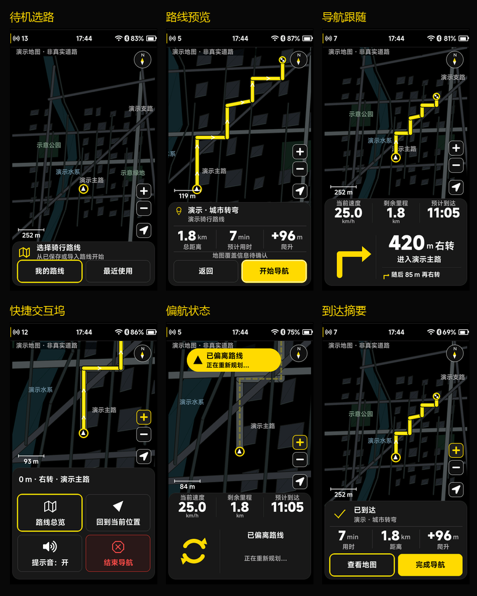

# 导航 UI v2.1 开发与接入说明

> 后续规则更新（2026-10-04）：当前“结束导航/完成导航”统一结束并保存骑行。下文旧结束规则属于该轮记录，当前行为以 [设置设备大卡片与导航结束保存_20261004.md](设置设备大卡片与导航结束保存_20261004.md) 为准。

> 本文保留初始 v2.1 的开发记录和数据接口说明。最新导航布局已按用户要求改为固定地图／交互坞卡片、两层编码器控制和实心液体胶囊选择；高度表、焦点和前台文案规则以 [导航固定卡片与胶囊选择](导航固定卡片与胶囊选择_20261003.md) 为准。

日期：2026-10-03。此文档描述当前已实现的软件；导航 UI v2.1 是界面规范编号，工程版本和已归档的 Git 标签仍为 v1.4.0。本轮未提交、推送或创建新标签。

## 1. 视觉和产品基准

以用户提供的 `11/12/13/14/15/16/18/19/20.png` 和 Navigation UI v2.1 冻结文字为基准。主要引导对应 15.png，快捷坞对应 18.png，路线内容对应 20.png；总览、准备、待机、到达、预览、偏航分别对应其余图片。

保留纯黑背景、中性灰表面、白色数值、灰色说明和黄色路线／主操作。红色仅用于结束导航等需要强调的操作。480×854 下按冻结稿规定的高度落地，图片中的字号、比例和信息密度按实际可读空间适配，不能把 941×1672 的效果图直接当作地图或整页背景。

地图背景仍是明确标注的 PC 演示几何，不是西安市真实地图。道路、水域、绿地、建筑和文字均通过地图窗口接口绘制；本次没有将效果图里的城市、路网或统计数字伪装成实际数据。

实际 LVGL 渲染：

## 2. 固定工作区与交互坞

导航工作区从 y=62 开始，结束于 y=838，底边距 16 px。地图对象位置与尺寸保持不变；底部共享容器承载导航面板，性能信息仍为系统顶层浮层，不占用产品布局高度。

| 状态 | 坞高度 | 当前行为 |
| --- | ---: | --- |
| 未选路线 | 144 px | 选择骑行路线、我的路线、最近使用 |
| 地点确认 | 208 px | 地点后端和规划能力可用时启用 |
| 准备路线 | 196 px | 等待异步读取结果，允许取消 |
| 路线预览 | 272 px | 名称、距离、预计用时、爬升、覆盖状态、返回／开始 |
| 正常引导 | 284 px | 三列实时数据、大转向图形、距离／道路、有效下一步 |
| 快捷操作 | 364 px | 总览、回到当前位置、提示音、结束导航 |
| 内嵌列表 | 484 px | 保留给工作区内的列表流程；路线内容主要使用独立列表页 |
| 错误／降级 | 328 px | 原因、当前有效信息和可执行恢复操作 |
| 到达摘要 | 256 px | 实际用时、距离、爬升，查看地图／完成导航 |

开始按钮发出请求后进入 STARTING，必须等待后端 ACK 才进入有效导航。结束导航不结束骑行记录。离开导航 UI 也不自动结束导航会话。

正常引导不再显示一串设置入口；快捷坞只有四个骑行中操作。路线导入、手机连接和离线地图管理放在辅助流程中。缺失能力显示未接入反馈或禁用操作，不产生假成功。

## 3. 输入与相机

- 触摸引导坞或上滑展开快捷操作，下滑收起。拖动时坞高度连续变化，地图对象不重建。
- 编码器在引导状态旋转缩放，按下展开操作；在列表／面板中旋转切换焦点、按下确认。返回先处理结束确认，再收起快捷坞／列表，再退出地图浏览，最后离开导航 UI。
- 地图实际拖动超过阈值才进入浏览，静止按住不会误切换。手动缩放保留跟随，并保存用户缩放偏好；回中恢复跟随。
- 总览按照有效路线和未被坞遮挡的区域适配；返回跟随恢复实时引导。新窗口更换地理原点后保留浏览中心。
- 坞展开过程中根据实际几何高度更新地图安全区域，把骑手位置安排在未遮挡区域约 73% 处，缩放和回中控制随安全区域移动。地图对象本身仍保持固定尺寸。
- 路口放大使用后端提供的路口和可选出口坐标；UI 不从路名、转向文字或任意路网猜测真实路口。没有出口坐标时不虚构出口位置。

共享阻尼弹簧负责坞形变和焦点胶囊，支持中途打断、反向、手势接管及减少动效设置。文字和数据不做拉伸变形。冻结稿中的动效时长作为调校目标，当前没有把 PC 动效表现或 FPS 当作 STM32 真机结果。

## 4. 路线内容和资源管理

“我的导航内容”是独立内容页，路线／地点标签、可滚动卡片、分页和底部操作共享一套实现。返回时恢复稳定条目 ID、滚动位置和分页偏移。“最近使用”读取已经开始过的路线，区别于最近地点。

路线卡只显示后端有效的名称、距离、爬升和预计用时。后端可提供最多 16 个地理缩略点；无缩略点时使用路线图标，不拼接假地图。PC 缩略点和路线明确标记为演示。

离线地图、地图详情、版本记录和空间管理读取对应后端目录。导入、检查更新、手机同步等按钮由能力和实际后端结果控制。当前 PC 后端只提供演示路线／地图目录及演示重算，不提供真实手机同步、地图导入、全城搜索或路径规划。

## 5. 状态与异步接口

新增 `src/services/ui_nav_store.h/.c` 合成界面快照。会话、引导、相机、面板和资源职责分开；快照不复制整份路网或地图几何。

| 接口 | 作用与调用侧 |
| --- | --- |
| `ui_nav_store_set_capabilities()` | 登记已实现的后端能力，默认零能力 |
| `ui_nav_store_get()` | UI 线程获取一致的会话／引导快照 |
| `ui_nav_store_command()` | UI 线程提交有 ID 的异步导航请求 |
| `ui_nav_session_submit()` | 后端任务提交权威会话及实际到达统计 |
| `ui_nav_session_complete()` | 后端任务返回请求完成结果和目录数据 |
| `ui_nav_session_submit_catalog()` | 后端任务更新有界目录／进度快照 |
| `ui_navigation_service_submit()` | 后端任务提交定位、转向、路口和下一步信息 |
| `ui_nav_map_provider_submit()` | 后端任务提交当前所需地图窗口 |
| `ui_nav_session_cancel_request()` | UI 线程只取消对应请求，避免取消其他页面的新操作 |

引导绑定 `session_id / route_id / route_revision / step_id` 和时间有效性；旧路线版本、回退步骤、旧采样不覆盖当前有效数据。定位过期或会话不匹配时撤掉无效引导、距离和 ETA，显示真实等待／降级状态。目录完成结果继承当前请求 ID，取消后的迟到结果不重启导航。

能力位覆盖路线、地点、规划、地图选点、路线导入、手机同步、地图目录、地图导入和重算。必须按实际实现登记；注册回调本身不代表支持所有操作。

坐标系统显式区分 WGS84 和 GCJ02，同一地图窗口坐标必须一致。新增 C 字段只是内部数据契约，不是可以直接 `memcpy` 到蓝牙或串口的协议；实际通信仍需版本、字段编码、长度检查和校验。

有界地图窗口当前最多含 48 条道路段、64 个路线点、64 个多边形区域和 12 个标签，目录每页最多 8 项。后端负责抽稀、分层和窗口选择，不能把整个西安路网一次塞入这些缓冲。

STM32 接入模板：`docs/examples/ui_navigation_adapter_example.h/.c`。`bike_ui_attach_navigation()` 接受工作队列回调和能力位。回调应复制请求并立即返回，由后台任务读取地图／解析路线／计算导航，再投递邮箱；传感器、存储、网络和算路任务不得直接调用 LVGL。

## 6. 硬件阶段仍需实现的内容

本轮只完成 UI 和软件接入契约。后续后端需要提供：

1. 西安真实地图资源及离线地图解码／索引，把地图数据转换为当前可见窗口；地图源、格式和坐标系需要单独确定。
2. GNSS 有效性、时间戳、速度／航向、路线匹配、转向步骤、偏航和到达判定。
3. 路线存储、导入、分页目录、最近使用记录及真实缩略数据。
4. 规划／重算服务，以及能力缺失、失败、取消和恢复的实际结果。UI 已支持状态展示，STM32 本地重算引擎尚未实现。
5. 手机通信和后台数据传输。高德 App 导航不会因本次 UI 开发自动同步到码表。
6. 地图和音频后台任务、存储访问、任务栈和内存预算、LTDC／DMA2D 刷新，以及真机帧率、输入延迟、功耗和续航测量。

应先验证“真实路线 + GNSS + 真实局部地图”的闭环，再增加手机同步和独立规划。PC 上的演示重算仅用于验收界面状态转换。

## 7. 本轮验证

- CMake/Ninja 构建成功，CTest 35/35 通过。
- 25 个导航状态按 480×854 生成真实 LVGL 截图，全帧与局部刷新逐像素一致。详细结果：`previews/navigation-v2.1/validation.json`。
- 覆盖取消／STARTING ACK、旧数据拒绝、离页后台提醒、缩放继续跟随、静止触摸、上滑／下滑、坞展开后骑手可见、地图对象身份、确认恢复焦点、偏航、弱定位、到达和完成导航。
- 120 次菜单中途打断／反转回放；预热后第二批堆占用、定时器和动画数量保持稳定。
- 8 个受保护的 PRTS／开机／首页／个人主页源文件 SHA-256 保持一致。

测试证明的是 PC 软件流程和刷新一致性，尚未证明 STM32 真机速度、真实地图正确性或实际道路导航能力。
