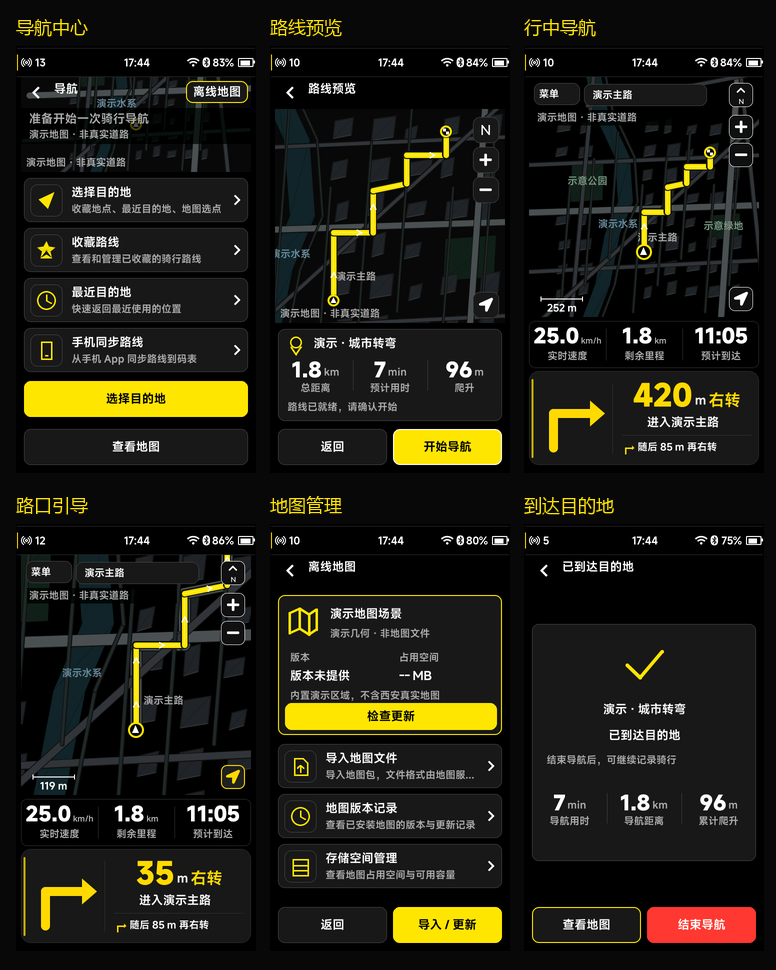

# Navigation UI v2.0 Final 实现说明

> 后续规则更新（2026-10-04）：当前“结束导航/完成导航”统一结束并保存骑行。下文旧结束规则属于该轮记录，当前行为以 [设置设备大卡片与导航结束保存_20261004.md](设置设备大卡片与导航结束保存_20261004.md) 为准。

日期：2026-10-03。工程：480×854 LVGL UI，基于 `v1.4.0`，本轮仍是未发布开发改动。

本轮以用户提供的 `3/4/5/6/7/8/10.png` 与定版文字为视觉及交互基准。采用纯黑背景、中性灰卡片、黄色实心主操作、白色正文和灰色说明；红色用于结束导航。水域与绿地仅在地图中使用低饱和颜色。参考图中的精细城市地形不是图片贴图，本工程通过有界地图几何接口绘制，可由后端替换为真实地图窗口。

## 页面与参考图对应

| 页面 | 本轮实现 |
| --- | --- |
| N01 导航中心，对应 3.png | 约 190 px 地图视觉区、定位状态、四个带图标底座的入口、上下排列的黄色主操作与查看地图。没有路线时主操作为选择目的地；上次会话可恢复时显示恢复。标题栏增加离线地图入口，便于导航前管理地图。 |
| N02 目的地选择 | 搜索入口、收藏/最近/手机导入分段选择、图标/名称/说明/有效距离列表、地图选点。搜索服务未接入时明确反馈；不显示虚构搜索结果。 |
| N03 路线准备 | 黄色加载环、实际目标名称、定位是否已提供、地图/路线/引导等待状态、取消和失败重试。未知阶段不打成功勾。 |
| N04 路线预览，对应 4.png | 428 px 大地图、起点/终点、路线箭头、比例与操作控件、目的地与距离/预计时间/爬升三列、黄色开始。完整概览由后端简化路线提供，不能用局部窗口代替。 |
| N05 行中导航，对应 5/10.png | 地图、94 px 三列数据条、188 px 转向坞。粗黄色转向箭头；距离、单位、动作；进入道路与下一步同时显示。当前位置跟随目标在地图约 73% 高度；默认运动方向朝上。 |
| 行中总览，对应 6.png | 全路线取景；速度列改为总距离；底部返回跟随/结束操作。属于相机状态，保留有效导航会话。 |
| 偏航与重算，对应 7.png | 地图上的黄色状态胶囊、重算加载环、旧路线虚线、短暂成功提示；失败提供返回原路线/查看地图/结束操作。关闭菜单不会取消后台重算。 |
| N06 地图管理，对应 8.png | 区域主卡、实际状态/版本/容量/范围、检查更新、导入地图、版本记录、空间管理。未提供容量和版本时显示占位；演示几何不算已安装地图。 |
| N07 收藏路线 | 独立页面及导航内列表，路线图标、名称、距离/爬升/预计时间、分页、预览与删除确认；空态提供手机同步/导入路线。 |
| N08 到达 | 黄色勾、目的地、独立有效的导航用时/距离/爬升、查看地图及结束。查看地图后保持该选择，后续定位快照不会反复跳回到达页。导航结束不结束骑行。 |

底部动作行固定为 `y=766`、高 `72 px`，内容底边 `838 px`。性能信息继续是顶层半透明浮层，不参与布局。状态栏沿用原工程；保留 PRTS 开机、首页、个人页与骑行页设计。

## 输入与动效

- 触摸点击与编码器执行使用相同动作入口。列表旋转移动焦点、按压执行，长列表显示右侧滚动条。
- 跟随中按压编码器打开快捷菜单；浏览/总览时按压回中。旋转缩放并进入浏览；手动浏览期间自动相机不接管。
- 菜单是覆盖地图的面板，提供总览、回中、方向、提示音、重算、结束。返回键先关闭菜单，再退出内部流程；不会隐式结束会话。
- 地图选点支持左右/上下/缩放及触摸拖动；缩放影响真实投影尺度，不能只放大图形而保持选点坐标步长不变。预览和选点的 N 为北向指示，行中 N 可切换方向。
- 面板与提示使用原有可打断弹簧；按钮按压/释放复用通用动效。地图采用平稳缓动，包含路口缩放、转向后保持、回中与总览取景；不把整张地图做液体形变。
- “减少动态效果”继续生效。PC 的渲染与生命周期测试不能推导出 STM32 真机已达到 60 FPS。

## 后端接口

基本接入顺序和工作队列示例见 [导航 UI 接入文档](NAVIGATION_UI.md)。本轮扩展如下：

| 接口数据 | 要求 |
| --- | --- |
| `ui_nav_map_frame_t` | 48 道路段、64 路线点、64 凸多边形区域、12 标签。区域是建筑/绿地/水域；局部点相对 `origin`，单位米，东正、北正。标签屏幕朝向保持可读，并避让控件。 |
| 地图窗口 | 原点/比例/坐标系/路线和地图版本必须有效一致。区域必须凸、有界、有限数值，标签必须有结尾 NUL。超过限制或混合坐标系拒收。 |
| `ui_nav_item_t` | 新增爬升有效位、版本字符串、覆盖范围、覆盖是否已确认/完整。距离/时间/容量/爬升分别由有效位控制。 |
| `ui_nav_catalog_t` | 新增手机路线、版本记录、空间管理目录与实际存储容量；可用空间不得超过总空间。目录按固定 8 条分页。 |
| 导入操作 | `UI_NAV_REQ_IMPORT_ROUTE` 发起路线导入，成功 ACK 返回可预览路线；`UI_NAV_REQ_IMPORT_MAP` 发起地图导入，成功 ACK 返回地图目录。文件读取、校验、传输、文件选择控制及进度由后端提供，本轮没有地图/GPX 解析器。GPX 不能作为道路底图。 |
| 到达摘要 | `elapsed_s/travelled_m/ascent_m` 各有有效位，来自导航会话，不用预估距离或计划用时充当完成统计。 |
| 提示音 | `ui_navigation_service_set_prompts_enabled()` / `ui_navigation_service_prompts_enabled()` 提供线程安全偏好；声音任务读取后决定提示。本轮未实现音频驱动。 |
| 引导类型 | 增加靠左/靠右、左右分叉、出环岛；下一步图标按实际动作绘制，跨页提醒正确区分左/右/环岛。 |

导航、地图提交接口复制数据到固定邮箱；生产者任务不调用 LVGL。原有请求 ID、超时、取消、迟到 ACK、旧会话/路线版本与来源检查继续生效。

PC 编译的 `sizeof(ui_nav_map_frame_t)=8624 B`、会话 `664 B`、目录 `2408 B`。这是单个结构的尺寸，不是 UI 总内存。邮箱、工作区、地图组件和任务临时副本都占空间；STM32 必须核对链接映射、任务栈峰值与 DMA/LTDC 缓冲。1024×1024 仅是虚拟几何坐标容器，不分配同尺寸 ARGB 图片来旋转地图。

## 实现边界与下一次验收

PC 中的建筑、水域、街区和路线都是明确标注的合成演示数据，坐标中心用于测试投影，不是西安真实地图。与效果图相比，目前不包含建筑模型、真实车道、交通灯、路口详图或道路准确性。这些需要地图样包及对应地物/道路/转向数据，不能由 UI 编造。

本轮没有实现 STM32/ESP32 算路、偏航检测、GNSS/BLE/高德同步、地图下载/解析、掉电导航恢复或真实音频。下一次验收应提供有来源、坐标系、版本的小范围西安地图包、路线及转向步骤，先接上述窗口接口，再测真机 IO、内存、帧时间与功耗。

实际验证结果与所有截图见 [本轮验收记录](NAVIGATION_UI_V2_VALIDATION.md)。
