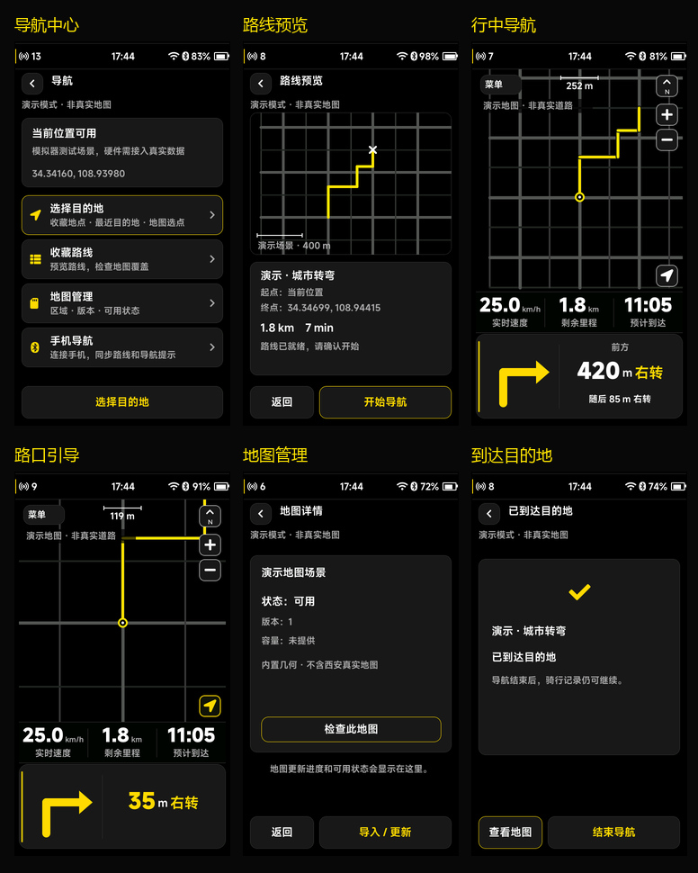

# 导航 UI 验收记录

此页记录首版导航实现。最新定版、截图和资源尺寸见 [导航 UI v2 验收记录](NAVIGATION_UI_V2_VALIDATION.md)。

日期：2026-10-03。分支：`feature/navigation-ui`。基线：`v1.4.0`。

导航 UI 已安装至当前 LVGL 工程，包括导航中心、目的地、地图选点、准备与预览、明确开始、行中引导、路口取景、收藏路线、地图管理、停止确认、到达与可恢复会话入口。接口与操作说明见 [导航 UI 接入文档](NAVIGATION_UI.md)。

## 验证结果

| 验证 | 结果与范围 |
| --- | --- |
| CMake/Ninja | 使用工程现有工具链构建成功，包含 STM32 导航工作队列接入示例的编译检查 |
| CTest | 34/34 通过，涵盖原有骑行、设置、报告、字体和新增导航服务/页面回归 |
| 完整导航流程 | 触摸、编码器、页面键、菜单与返回；取消、重试、明确开始、跨页持续、停止、删除与到达通过 |
| 请求与来源 | 匹配 ACK、旧回复拒绝、取消、超时和时钟回绕、来源切换及已停止会话不可复活通过 |
| 数据有效性 | 路线版本、坐标系、几何上限、非法数值、独立定位/航向有效位及仅路线无底图状态通过 |
| 相机与提醒 | 手动浏览优先、无航向时保持稳定、同方向相邻步骤提醒及距离更新不重复通知通过 |
| 菜单反复操作 | 60 次在弹簧运动中打开/关闭；返回相同状态后 LVGL 堆占用、分配数量、定时器与动画数量稳定，堆完整性检查通过 |
| 渲染一致性 | 22 个导航场景的全帧与局部刷新截图在 480×854 分辨率下逐像素一致，含顶部状态栏 |
| 视觉与日志 | 检查长文本、图标字形、地图比例尺、固定底边和操作按钮；未发现字体缺失、图层分配失败或内存不足 |

菜单回放的独立组件测试稳定堆占用为 28,312 B、定时器为 6 个。这仅是该测试场景的 LVGL 堆统计，不是整个工程或 STM32 的 RAM 总量。集成测试中的 `-1001` 保存错误属于既有故障注入，用于验证保存失败后的恢复流程，最终测试通过。

逐场景渲染记录见 [validation.json](previews/navigation/validation.json)。场景包括导航中心、目的地/地点列表、选点、准备/预览、行中、接近/迫近、跨页提醒、菜单/停止、地图列表/详情/不可用、环岛、重算失败、弱定位、到达及收藏路线预览/删除。

## 交付边界

PC 演示使用人工道路和路线，并在页面中标记演示；它不是西安真实地图。真实地图包解析、路径规划、偏航重算、GNSS、蓝牙/高德同步及地图传输仍由后端实现。真实地图取景与道路精度需使用同一坐标系的小范围样包和轨迹验收，STM32 帧率、栈峰值、缓存和续航需真机测量。

沿用纯黑、灰色、白色和黄色主题，产品底边为 838 px，底部操作按钮为 72 px；FPS 继续作为透明顶层覆盖。PRTS 开机动画未修改，`VERSION` 和已有 `v1.4.0` 标签保持不变；本轮开发未创建或推送新版本。
