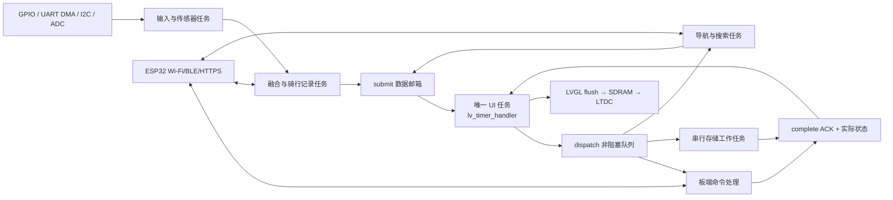

# LVGL 到 STM32 全流程接入指南

> v1.5.2 归档说明：本文保留 2026-10-06 的核验来源、版本和行号；当前软件接入入口见 [STM32 v1.5.2 接入说明](../STM32_V1.5.2_INTEGRATION.md)。硬件和固件来源仍为本地独立工程，本版 Git 仅归档 LVGL 软件及相关说明。

> 2026-10-09 输入契约变更：实体按键消抖、单双击、长按与编码器解码现由 STM32 InputService 负责；旧 sample_inputs/set_key_map/submit_input 已删除。本文输入部分及原行号属于历史快照，新接入须使用 [实体输入架构与队列契约](../输入架构重构_20261009.md)，触摸与其余端口不变。


核对日期：2026-10-06。UI 软件版本 `1.5.1`；本轮核对的本地 Git 基线 `fd1db03db101cee2306c9829d153a090046239a0`。本文件是实施说明，不代表下面的板端驱动已经完成。本轮只生成接入资料，没有修改应用代码、固件、CubeMX 配置、版本号或 Git 历史。

工程根目录：`D:/Postgraduate_Program/111AAALearn_Lab/111AAABikeComputer`。本指南核对的最终工程位置如下：

| 核对对象 | 最终本地路径 |
| --- | --- |
| LVGL 工程 | `D:/Postgraduate_Program/111AAALearn_Lab/111AAABikeComputer/Software/Lvgl_Project` |
| STM32 固件 | `D:/Postgraduate_Program/111AAALearn_Lab/111AAABikeComputer/Software/STM32_Project` |
| 原理图和数据手册 | `D:/Postgraduate_Program/111AAALearn_Lab/111AAABikeComputer/Hardware` |
| 本套接入资料 | `D:/Postgraduate_Program/111AAALearn_Lab/111AAABikeComputer/Software/Lvgl_Project/docs/STM32接入说明_20261006` |

下文 UI 路径相对于 `Software/Lvgl_Project`，固件路径相对于 `Software/STM32_Project`。本指南没有使用 `111AAABike_SpeedView` 的软件源码。

本次依据是上述最终目录的**本地工作区**，不是对 GitHub 文件完整性的声明。Git 基线用于标识已提交的 UI 历史；本次核对的 STM32 工程和 2026-09-21 硬件资料在检查时尚有未跟踪文件，仍以本地真实文件为准。配套核验报告保留引用文件的 SHA-256，便于以后判断资料是否过期。

配套资料：[板端结构成员与回调](STM32接口变量与回调清单.md)、[接口清单 CSV](STM32接口变量与回调清单.csv)、[原理图与 CubeMX 引脚核对 CSV](STM32硬件引脚核对.csv)。接口清单从 25 个头文件提取了 55 个结构体、380 行成员/回调声明；一行可能声明多个变量。引脚表覆盖 140 条 MCU GPIO 网络记录。它们是精确查找表；本指南说明单位、生产来源、实现职责和操作顺序。

## 1. 先明确当前工程真正处于哪一阶段

**事实：** UI 已有板端服务入口、异步命令、数据质量、骑行统计、历史事务、离线地图/搜索/算路算法；实际 STM32 工程还没有把这些连起来。`App_Main()` 主要初始化调试串口，`SystemTask` 每秒增加心跳；`board.c/h`、`spl06.c/h`、`board_config.h`、`app_config.h`、`app_types.h` 仍为零长度占位，`i2c_bus.h` 只有 2 字节。

**判断：** 此工程有可复用的 UI 和业务边界，不能描述为“将几个变量赋值后就完成整机”。最少还需要显示端口、内存初始化、输入任务、传感器协议、记录/融合任务、存储任务和 ESP32 固件协议。

**边界：** 以下硬件结论以 `Hardware/SCH_Schematic1_2026-09-21.pdf` 和同日期 `.tel` 网表为主。资料目录中的 BMP280、L76K、STM32H732 等备用数据手册不表示它们实际装在这块板上。Gerber/BOM 文件名日期早于这份原理图，需要把最终 PCB/实际焊接型号与图纸再对照；本轮没有实物电气测量。

## 2. 按原理图确认的硬件与接入状态

| 功能 | 图纸中的实物/接口 | 软件应该接入什么 | 当前固件状态 |
| --- | --- | --- | --- |
| 主控 | U1 STM32H743IIT6，第 2 页 | HAL、FreeRTOS、LVGL 9、融合和文件服务 | 最小系统已建；UI 未移植 |
| 显示 | D300T9307V1，480×854；ST7701S，RGB565 16 根数据线 + 3 线串行初始化，第 3 页 | LTDC、屏幕寄存器初始化、DMA2D/flush、背光 PWM | 无 LTDC/DMA2D 配置 |
| 触摸 | FPC2，I²C 与 INT/RST；资料提供 FocalTech FT5x16 系列 | I2C1 触摸读数、坐标转换、输入事件 | I2C1 已配；触摸驱动未接。具体 IC ID 需读实物确认 |
| 外部 RAM | U3 W9825G6KH-6，256 Mbit，即 32 MiB SDRAM，第 2 页 | FMC SDRAM、初始化命令、刷新周期、MPU、链接分区 | 无 FMC 配置 |
| 外部 Flash | U4 W25Q128JVEIQ，128 Mbit，即 16 MiB，第 2 页 | QSPI JEDEC/读写/擦除；可存字体、资源、配置 | 无 QSPI 配置 |
| 大容量存储 | CARD2 TF，SDMMC2，第 2 页 | SDMMC2 + FatFs、地图和活动日志 | 未配置 |
| GNSS | J10 外接 GNSS，USART2，第 5 页 | NMEA/模块协议、fix/卫星/经纬度/速度/UTC | USART2 RX DMA 已配；解析未实现。图纸只确定连接器，不确定 ATGM336H 或 L76K 的装配选择 |
| 气压 | U11 SPL06-001，第 5 页 | I2C1 补偿气压、温度、滤波海拔/坡度 | 文件空占位 |
| 无线 | U9 ESP32-S3-WROOM-1，第 4 页 | UART5 协议、Wi-Fi、BLE central、手机通信、HTTPS 补充搜索 | STM32 对应 UART5 尚未配；未查到此工程里的 ESP32 业务实现 |
| 电量/充电 | PC4 电池分压；BQ24075 CHG#/PGOOD#；TPS63070 PG，第 6 页 | ADC、电量估算、充电/输入电源状态 | 未配置 ADC 与状态输入 |
| 背光 | PA1→MP3302 EN/PWM，第 3 页 | PWM、亮度、关屏 | 未配置 PWM |
| 声音 | PA2 无源蜂鸣器；PA3 音频 PWM、PC5 功放使能，第 7 页 | 提示音任务；语音还需 PCM/解码/资源 | 未配置 |
| 操作 | 5 个功能键、编码器 A/B/按压，第 7 页 | 去抖、长按、双击、四相解码、语义事件 | GPIO 输入已配，业务扫描未实现 |
| 整机电源 | TPS63070 EN 与 PS/SYNC 共接 EN_PS，通过 R35 接 SYS_PWR；BQ24075 SYSOFF 接地，第 6 页 | 安全保存、软关机/低功耗、唤醒 | 没有 MCU 可控的切断整机供电信号 |

### 2.1 当前应补进 CubeMX 的外设

现有 `.ioc` 列出的外设是 CORTEX_M7、DEBUG、DMA、FREERTOS、I2C1、MEMORYMAP、NVIC、RCC、SYS、USART1、USART2。需要逐项新增 **FMC、LTDC、DMA2D、QUADSPI、SDMMC2、FatFs、UART5、ADC、背光/蜂鸣器/音频定时器、RTC、触摸/电源状态 GPIO**。按实际资源选择 DMA 通道与中断，不照抄 PC CMake。

重要引脚如下；其余 FMC 全部地址/数据线见配套 CSV，不能只配下面的控制线。

| 网络 | STM32 引脚 | 接入说明 |
| --- | --- | --- |
| GNSS_RX / GNSS_TX | PD5 USART2_TX / PD6 USART2_RX | 标签以模块接收/发送为参照。STM32 RX 接模块 TX |
| ESP32_RX / ESP32_TX | PC12 UART5_TX / PD2 UART5_RX | 分别通过 R68/R63 接 ESP32 IO18/IO17；名称同样以 ESP32 方向为参照 |
| ESP32_READY / ESP32_WAKE | PH2 / PH3 | 通过 R69/R70 接 IO16/IO15；建议 READY 输入、WAKE 输出，实际电平协议由两端约定 |
| I2C_SDA / I2C_SCL | PB7 / PB8 | I2C1，共享 SPL06 与触摸；总线访问串行化 |
| TP_INT / TP_RST | PB12 / PB9 | 网表名称为 PB12/PB9；对应 FPC2 第 2/1 脚。复位为输出，INT 按触摸 IC 规格设 EXTI |
| LCD_SPI_CS / SCL / SDA | PA4 / PB13 / PB5 | 用于 ST7701S 命令初始化，像素不通过这三根线传输。当前引脚组合建议先用 GPIO 实现 9 位串行协议；不假定它们能组成同一硬件 SPI |
| LCD_RST / LCD_BL_PWM | PI10 / PA1 | 屏幕低有效复位，背光 PWM 候选 TIM2_CH2；复位与 PWM 参数按屏/升压芯片规格确认 |
| LCD_HSYNC / VSYNC / DE / PCLK | PC6 / PI9 / PF10 / PG7 | PCLK 从 PG7 经 R18 到 FPC；配置相应 LTDC 复用 |
| LCD_R0…R4 | PB0、PA5、PA12、PB1、PG6 | 对应 RGB565 红色高 5 位的 LTDC 输出；不要把原理图 R0 标签误配为 MCU 的 LTDC_R0 |
| LCD_G0…G5 | PA6、PG10、PB10、PB11、PC7、PD3 | 对应绿色高 6 位 LTDC 输出，逐项核查 AF |
| LCD_B0…B4 | PG11、PI4、PI5、PI6、PI7 | 对应蓝色高 5 位 LTDC 输出，逐项核查 AF |
| FMC_SDNE0 / SDCKE0 | PC2_C / PC3_C | 176 脚封装第 34/35 脚。必须核对 H743 PC2/PC3 与 PC2_C/PC3_C 模拟开关连接和 SYSCFG 设置，不把普通 PC2/PC3 开发板例程直接当作本板配置 |
| FMC_SDCLK / RAS / CAS / WE | PG8 / PF11 / PG15 / PC0 | 使用 SDRAM bank1；通常映射基址 0xC0000000，最终由 FMC 配置确认 |
| QSPI CLK / CS / IO0…IO3 | PB2 / PB6 / PF8、PF9、PF7、PF6 | CLK 经 R14；QSPI bank/AF、QE 与读命令需按器件实现 |
| SDMMC2 CK / CMD / D0…D3 | PC1 / PD7 / PB14、PB15、PB3、PB4 | CK 经 R15；先低速枚举，再验证 4 位模式。图纸无可用 MCU 卡检测线，处理读写失败/热拔卡 |
| 电池测量 | PC4 | BAT_ADC 经 R37 到网表 PC4，ADC 输入；R34/R36 是 100k/100k，电池电压约为 ADC 节点电压的 2 倍 |
| STAT_N / PGOOD_N / DCDC_PG | PH4 / PH5 / PH6 | 低电平充电、低电平输入电源有效、3V3 PG；逐一核实芯片定义与上拉。CHG# 不等于有线充电器插入 |
| BUZZER_PWM / ST_AUPWM / ST_AUEN | PA2 / PA3 / PC5 | 候选 TIM2_CH3/CH4 与 GPIO；与背光可同计时器但须协调频率，音频 PWM 与背光不同频率时不能共用 TIM2 的同一个周期 |
| 调试串口 | PA9/PA10 USART1 | 经 CH340N；当前 115200。不是 MCU 原生 USB 数据服务 |

### 2.2 在写业务前就应该解决的问题

1. **编译器兼容：** Keil 工程现在 `<uAC6>0</uAC6>`，FreeRTOS include 指向 RVDS/ARM_CM4F；UI 使用 `<stdatomic.h>` 和 C11 原子。先确定 Arm Compiler 6 或支持此 C11 契约的板端工具链，并选择与编译器及 Cortex-M7 修订匹配的 FreeRTOS port。不能只把 C 文件加入旧 ARMCC5 工程后期待直接通过，也不能只改 AC6 开关而保留不兼容汇编端口。
2. **资源编译：** 当前 `lv_conf.h` 是 PC 配置：SDL=1、LV_MEM_SIZE=1 MiB、TinyTTF=1、多项 demo=1。要另建板端配置，并依据真正调用保留 draw/font/widget 功能；不要裁掉 UI 需要的图像旋转、canvas、动画和字体。`LV_USE_OS=LV_OS_NONE` 可以配合“唯一 UI 任务”使用；若改用 LVGL 自身 RTOS 锁，还需正确实现其 OS port。工程邮箱锁与 LVGL 内部锁是两件事。
3. **GNSS 波特率：** 当前 USART2=115200，ATGM336H-5N31 资料的默认值是 9600。若最终装 ATGM 且没有配置过，应先用 9600 验证；若装另一型号，按其真实设置。波特率不匹配会导致永远无法定位。
4. **显示资料：** 供应商压缩包是别的开发板示例，其触摸 GPIO 和 SDRAM 时序不能照搬。本板 3 线命令协议、初始化表、DE/HS/VS/PCLK 极性要按实际 ST7701S 面板版本验证；面板资料部分描述不能替代测量。先显示红绿蓝测试图再接 UI。
5. **关机实现：** 图纸中的 EN_PS 不是 MCU 输出。当前只能设计“保存完成→关闭背光/外设→MCU 低功耗”，ESP32/其他电源域的剩余耗电需另测。要真正零待机整机断电，需要硬件电源保持/负载开关等方案，不能靠 `SYSTEM_SHUTDOWN` 名称实现。

## 3. 全流程架构：每类任务分别负责什么



建议任务划分是实现方案，不是现有固件已经创建的任务列表。

| 任务 | 主要职责 | 调用边界 |
| --- | --- | --- |
| UiTask | `lv_init`、显示/indev、注册端口、`ui_app_init`、持续 `lv_timer_handler` | 所有控件、页面函数、观察者只在这里执行 |
| InputTask | GPIO 按键、编码器解码、触摸扫描/坐标快照 | 使用输入邮箱；约 5–10 ms 扫描是起始建议，编码器边沿捕获更快 |
| GnssTask | DMA ring/IDLE 通知→帧解析→校验 fix/位置/UTC | ISR 只通知；任务形成原始 GNSS 样本 |
| SensorTask / PowerTask | SPL06、ADC、电源 GPIO、过滤/标定 | 不调用控件；采样频率按数据手册与功耗需求选择 |
| FusionRecordTask | 单一骑行会话 owner、源融合、距离/计时/累计、原始日志 | 统一提交 `ui_ride_data_t`，按时间和会话顺序发布 |
| BoardCommandTask | 命令队列路由与实际执行、超时/幂等、ACK 重试 | 队列复制 `ui_command_t`，不能保留 UI 临时指针 |
| StorageTask | FatFs、保存事务、历史页、配置、地图随机读 | 大块 I/O 串行；不调用 LVGL；若导航独立任务读同文件系统，使用专属句柄和明确文件锁 |
| NavTask | 规划、地图窗口、匹配/偏航/转向、搜索/网络补充协调 | 与记录会话分开，完成请求用原 request id |
| EspLinkTask / SoundTask | ESP32 framed protocol、通知/媒体；PWM/音频输出 | 状态回报到邮箱，UI 回调只入队 |

FreeRTOS 当前 `configTICK_RATE_HZ=1000`，heap=15360 字节，默认任务栈 512 字节，SystemTask 栈 512 个 `StackType_t`（本 port 通常是 2048 字节）。这些不是完整 UI/导航所需预算。优先静态分配任务/队列，按栈高水位、链接 map 和长期运行实测设置大小。不可把 32 KiB JSON 解析临时数组放进 2 KiB 任务栈。

### 3.1 线程和锁规则

- `ui_stm32_services_register()` 必须得到非空 `dispatch_command`、`lock`、`unlock`；锁推荐 RTOS mutex。初始化在任务开始生产数据前完成。
- 各 `submit` / `complete` 入口是**任务上下文** API；ISR 使用 `…FromISR` 队列/通知再由任务提交。当前 FreeRTOS 可调用系统 API 的 ISR 优先级界限为数值 5；核对 NVIC 分组和每个中断优先级。
- 不使用默认 atomic spinlock 替代 RTOS mutex：低优先级任务持锁被高优先级任务抢占时，自旋可能使持锁者无法运行。
- 注册回调 `dispatch/tick/request` 在 UI 上执行，必须立即返回；不做 HAL 阻塞 I²C、UART、FatFs、HTTP、音频等待。
- 不在持有邮箱锁时调用 I/O 或 LVGL；不从传感器任务调用 `ui_app_state_set_*`、`ui_*_page_set_*`。
- UI 内部已有 20 ms `app_event_timer_cb`，负责 mailbox drain、命令/状态/天气/配置、导航和输入处理。只持续运行 `lv_timer_handler()`，不要在其他任务再手动 process 同一模型。

## 4. 骑行数据：每个真实变量从哪里来

入口：`ui_stm32_services_submit_ride_data(const ui_ride_data_t*)`。完整数据在任务中复制；UI 内部会更新统计，之后刷新显示。推荐各传感器先到 FusionRecordTask，避免独立任务提交完整快照把其他字段清零。

### 4.1 17 个质量字段与实际成员

| 字段枚举 `UI_RIDE_FIELD_*` | `ui_ride_data_t` 成员 / C 类型 | 来源和 STM32 实现 | 单位与关键处理 |
| --- | --- | --- | --- |
| SPEED | `speed` / float | GNSS 有效速度，或 ESP32 BLE CSC 轮速；融合任务择源 | km/h；GNSS knots×1.852，m/s×3.6；轮速由计数差、轮周长和传感器时间差计算。静止 0 有效 |
| HEART_RATE | `heart_rate` / uint16_t；`heart_rate_zone` / uint8_t | ESP32 BLE Heart Rate Service 0x180D/0x2A37，按 flags 读取 8/16 位值；区间由配置推导 | bpm；0 或断连无效；zone 应与界面 5 区约定一致 |
| POWER | `power` / uint16_t | ESP32 BLE Cycling Power 0x1818/0x2A63；处理 flags、带符号瞬时功率与设备语义 | W；本 UI 无法表达负功率，负值须明确过滤/转换策略；真实 0 W 保持有效 |
| CADENCE | `cadence` / uint16_t | BLE CSC 0x1816/0x2A5B 或 Cycling Power 的曲柄计数/事件时间 | rpm；按规范处理计数/时间环绕，滑行 0 合法；没有数据不能以 0 伪装 |
| GRADE | `grade` / float | 滤波高度差/地表行进距离×100；必须先有足够移动距离 | %；上正下负；低速或 GNSS 跳点时置无效，不能每帧差分气压直接求坡度 |
| DISTANCE | `distance` / float | 单一记录任务累计轮速距离或经过精度/跳点筛选的 GNSS 距离 | km；暂停期间冻结；源切换连续，不重复累计 |
| AVERAGE_SPEED | `average_speed` / float | 有效活动距离/记录活动时间 | km/h；无有效分母时无效，不除 0。报告内部也会生成均速，保持同一定义 |
| MAXIMUM_SPEED | `maximum_speed` / float | 会话内通过异常值过滤后的速度最大值 | km/h；避免单个坏 GNSS 包创最高速 |
| ALTITUDE | `altitude_m` / int32_t | SPL06 补偿压力→相对/标定海拔；可用 GNSS 做慢校准 | m；允许负海拔；压力算法需要 p0/标定策略，不能把气压直接当米 |
| ASCENT | `ascent_m` / uint32_t | 过滤后正高度变化累计，加入迟滞/最小变化阈值 | m；暂停冻结，气压漂移不累计；下降统计由报告模型形成或后端日志另存 |
| CALORIES | `calories_kcal` / uint32_t | 功率积分/效率模型或基于用户参数的估算 | kcal；本板无热量传感器；当前配置没有体重/年龄接口，没有可靠算法时不支持/无效，不能沿用演示乘数 |
| TEMPERATURE | `temperature_c` / int8_t | SPL06 补偿温度可作板内温度；若要环境气温需验证热偏差/另用环境传感器 | 整数 °C，范围受 int8_t 限制；0 °C 有效。它不等于互联网天气温度 |
| TIME | `clock_hour`,`clock_minute` / uint8_t | RTC 缓存或 GNSS UTC 加统一时区转换 | 0–23/0–59，本地时间；不能使用 PC `time()` 默认假定板端已设 RTC |
| GNSS | `satellites` / uint8_t | 解析模块卫星数并统一“参与解算/可见”的显示口径 | 个；卫星数大于 0 不代表有有效 fix |
| BATTERY | `battery` / uint8_t | PC4 ADC、VREFINT 校正、分压、电池曲线/滤波 | 0–100%；不是 ADC 12/16 位原始值；与状态栏同一份结果 |
| LAP | `current_lap`,`total_laps` / uint8_t | 记录任务的圈状态；后续可加自动圈/物理标圈策略 | 当前协议有圈数据，**没有新增圈命令**；不能声称按某键已能打圈 |
| POSITION | `latitude`,`longitude` / double | 有效 GNSS 位置；统一 WGS84 后提交 | 十进制度；NMEA ddmm.mmmm 转 degrees+minutes/60，并按 N/S/E/W 加符号；`0,0` 不能作为无效哨兵 |

### 4.2 时间、会话、质量元数据：同样必须接入

| 成员 | 必须如何填 |
| --- | --- |
| `sample_time_ms` / uint32_t | 融合快照形成时刻，必须与 `lv_tick_get()` 同一单调毫秒时钟域 |
| `timer_ms` / uint64_t | 当前骑行实际活动毫秒；START 清零、PAUSE 冻结、RESUME 继续、FINISH 停止。切页、关屏、UI 卡顿都不能改变它 |
| `ride_seconds` / uint32_t | 与上述活动时长一致，通常 `timer_ms/1000`，不是开机时长 |
| `timestamp_utc` / int64_t | Unix UTC 秒，未获得真实 UTC 时填 0；不能把本地时间再次当 UTC 存档 |
| `session_id` / uint32_t | 使用 `UI_COMMAND_RIDE_START.value` 按 uint32_t 解释的标识。新会话用完整快照建立，不用旧会话 patch |
| `quality_known` / bool | 真实板端一律 true，避免旧接口靠数字是否为 0 猜有效性 |
| `capability_flags` / uint32_t | 17 个字段中哪些功能存在；无 BLE 功率计时不能把功率位无条件置 1 |
| `valid_flags` / uint32_t | 本次哪些值有效；必须是 capability 的子集。断连、失败、未标定时清相应位 |
| `quality[i].sampled_at_ms` | 该传感器真实采样时间；心率旧数据不能因融合任务每帧重新提交而被“续命” |
| `quality[i].stale_after_ms` | 过期时间；按采样周期/断连检测设。0 表示不自动过期，主要用于受控累计计数；实时 HR/GNSS 不要设 0 |
| `quality[i].source` | GNSS、WHEEL、BLE、BAROMETER、BOARD、FUSED；真实板不使用 DEMO |

使用 `ui_ride_data_set_quality()` 设置能力、有效位和质量元数据，避免手写位不同步。例：GNSS 1 Hz 时可先尝试速度/位置 2–3 秒过期；这是起始调试值，不是固定要求，应由实测确定。

**patch 的容易忽略之处：** `submit_ride_patch(patch, fields)` 即使只改心率，也会更新 `sample_time_ms/timer_ms/ride_seconds/session_id/timestamp_utc` 公共头。其质量必须显式；旧快照、不同非零会话会被拒绝。新会话从完整快照开始。不要让每个传感器任务自行填写公共头；由 FusionRecordTask 统一提交。

**算法与日志：** UI 汇总统计在每次 producer submit 时更新，不只在屏幕刷新时更新；但 HR/功率均值是离散时间加权近似，丢失长区间不能补回。报告最多 120 个预览点，原始逐秒日志/FIT/GPX 必须由板端另存，不能把预览数组当完整运动记录。

### 4.3 数据提交示意

下面是拟实现片段，`record`/`gnss` 是板端要建立的业务对象，当前工程没有这些对象；质量函数和提交 API 为当前真实接口。

```c
ui_ride_data_t frame = {0};
frame.quality_known = true;
frame.sample_time_ms = board_now_ms();
frame.session_id = record.session_id;
frame.timer_ms = record.active_ms;
frame.ride_seconds = (uint32_t)(record.active_ms / 1000U);
frame.timestamp_utc = rtc_cache.utc_valid ? rtc_cache.utc_seconds : 0;
frame.speed = gnss.speed_kmh;
frame.latitude = gnss.latitude_wgs84;
frame.longitude = gnss.longitude_wgs84;
ui_ride_data_set_quality(&frame, UI_RIDE_FIELD_SPEED,
    true, gnss.fix_valid && gnss.speed_valid, gnss.sampled_ms,
    2500U, UI_DATA_SOURCE_GNSS);
ui_ride_data_set_quality(&frame, UI_RIDE_FIELD_POSITION,
    true, gnss.fix_valid, gnss.sampled_ms, 2500U, UI_DATA_SOURCE_GNSS);
/* 按 4.1 表补齐其余已有能力；未实现的字段保持 unsupported。 */
ui_stm32_services_submit_ride_data(&frame);
```

## 5. 状态栏与控制状态：整组回报，不是直接改图标

入口 `ui_stm32_services_submit_state(&snapshot, mask)`，结构 `ui_state_adapter_snapshot_t`。状态组提交会复制该组所有成员；应由一个状态 owner 保存完整状态后提交，不能只初始化想改变的一个 bool。

| mask | 全部成员 | 板端来源/处理 |
| --- | --- | --- |
| STATUS | `clock_hour`,`clock_minute`,`battery_percent`,`battery_charging`,`status_quality_known`,`clock_valid`,`battery_valid` | RTC+PowerTask；真实 quality_known=true，RTC 未同步 clock_valid=false、ADC失败 battery_valid=false；电量和骑行 battery 同源 |
| GNSS | `gps_enabled`,`satellites` | 模块真正开启状态和 GNSS 缓存；当前接口不能凭 GPIO 名称假定可切断 GNSS 电源，先实现模块协议睡眠/唤醒 |
| SATELLITES | `satellites`，提交实现也复制 `gps_enabled` | 用同一 GNSS 状态快照；UI publish 时单独更新卫星数，避免提交结构不一致 |
| CONNECTIVITY | `wifi_enabled`,`wifi_connected`,`bluetooth_enabled`,`bluetooth_connected`,`wifi_name[32]`,`bluetooth_name[32]` | ESP32 确认开关/连接/名称后反馈；enabled 与 connected 不相等；名称 UTF-8 并保证 NUL 结尾 |
| CONTROL | `sound_level`,`brightness_level`,`power_save_enabled` | 声音/背光/低功耗策略实际应用后的状态，0–100；省电不能停掉记录任务 |
| TOUCH_LOCK | `touch_locked` | 板端/UI 触摸策略确认；锁定时保留按键唤醒和解锁路径 |
| MEDIA | `media_playing`,`media_track`,`media_mode` | 真正的手机/媒体协议状态。mode 为 sequence/repeat-one/shuffle；track 只是 uint8 索引，不是完整歌曲 metadata |
| NAVIGATION | `navigation_active` | 导航任务状态；主 UI 会从 `ui_nav_session_active()` 再对账，不能只把此 bool 置 true 而没有导航会话 |

`ui_app_state_t.current_route/ride_state/version` 是 UI 路由、骑行状态机、发布代数，**不是传感器要直接赋的变量**。骑行状态依赖命令 ACK 和内部控制器；数据有效位与真实状态回报才是硬件入口。

## 6. 从物理按键到操作：按现有图纸逐键映射

GPIO 已配置上拉，原理图按键按下接地，所以 `HAL_GPIO_ReadPin()==GPIO_PIN_RESET` 表示按下。传给 UI 的 mask 则 **1 表示按下**。

| 物理引脚/网络 | `UI_HW_KEY_*` | 当前 STM32 注册后的短按 | 长按（1200 ms） |
| --- | --- | --- | --- |
| PA0 KEY_PWR | POWER | `UI_INPUT_POWER_TOGGLE`，进入现有电源/屏幕逻辑 | `UI_INPUT_OPEN_POWER`，打开电源操作界面 |
| PD11 KEY_BACK | BACK | `UI_INPUT_BACK`，返回；见下文双击问题 | `UI_INPUT_BACK_LONG`，交由当前页面/骑行逻辑处理 |
| PD13 KEY_PGUP | PREVIOUS | `UI_INPUT_PAGE_PREV` | 禁用 |
| PC13 KEY_PGDN | NEXT | `UI_INPUT_PAGE_NEXT` | 禁用 |
| PD12 KEY_MENU | MENU（RIDE 的别名） | `UI_INPUT_TOGGLE_CONTROL_CENTER` | `UI_INPUT_RIDE_TOGGLE`，按当前骑行状态发起准备/开始/暂停等流程 |
| PG12 ENC_SW | ENCODER | `UI_INPUT_ENCODER_PRESS`，确认当前选项 | `UI_INPUT_TOGGLE_CONTROL_CENTER` |
| PG3 ENC_A + PD4 ENC_B | `encoder_delta` | 一格顺时针→CW；逆时针→CCW | 不属于按键长按 |

传入 `ui_stm32_services_sample_inputs(pressed_mask, encoder_delta, now_ms)`。当前统一模块去抖 25 ms；短按在松开稳定后触发，长按触发后不再发短按。一次 sample 最多发 4 个编码器 step，pending 被限制 ±64；非常快的旋转仍可能丢细节。

**编码器实施：** PG3 与 PD4 并不是同一个定时器的一对 encoder 输入，先采用 A/B 状态表软件四相解码或 EXTI 捕获，按实际每 detent 边沿数归一化；不要把每个边沿当一格。5–10 ms 按键扫描不足以保证捕获所有快速旋转边沿，编码器可单独更快采样或中断记录，业务事件仍从 InputTask 发送。

**返回双击：** 通用 `ui_hardware_input_sample()` 不生成 `UI_INPUT_BACK_DOUBLE`。要保留骑行返回键双击/长按逻辑，关闭统一模块 BACK 的 short/long 映射（设 `UI_INPUT_COUNT`），对**已经去抖**的 BACK 使用 `ui_back_key_gesture_update()`；其窗口 double=280 ms、long=1200 ms，分别发送 BACK/BACK_DOUBLE/BACK_LONG。不能同时保留默认 BACK 又额外发送双击，以免单击先被执行。

按键 mask 示例（目前已有宏）：

```c
uint32_t mask = 0;
if (HAL_GPIO_ReadPin(KEY_PWR_GPIO_Port, KEY_PWR_Pin) == GPIO_PIN_RESET)
    mask |= UI_HW_KEY_BIT(UI_HW_KEY_POWER);
if (HAL_GPIO_ReadPin(KEY_MENU_GPIO_Port, KEY_MENU_Pin) == GPIO_PIN_RESET)
    mask |= UI_HW_KEY_BIT(UI_HW_KEY_MENU);
/* 同样加入 BACK、PGUP、PGDN、ENC_SW；delta 为已归一化的格数。 */
ui_stm32_services_sample_inputs(mask, delta, board_now_ms());
```

### 6.1 触摸必须接两层，各做不同职责

PC `src/hal/hal.c` 同时创建 LVGL pointer indev 和语义触摸队列。板端需要同样保留两条路径：

1. 触摸任务读取 FT 实际寄存器，生成校准后的屏幕坐标快照；LVGL `lv_indev` 的 read callback **只读取缓存**，返回 `point.x/y` 和 pressed/released，使现有 LVGL 按钮/滚动正常工作。
2. 同一校准坐标流通过 `ui_stm32_services_submit_input()` 发送 `TOUCH_BEGIN/MOVE/END/CANCEL`，由 `ui_app_handle_pointer()` 处理页面滑动、抽屉、滑块与导航地图手势。

这不是把同一点击手工重复执行两次。不要同时在驱动回调手动调用按钮 action；保持现有 UI 的手势所有权、取消 LVGL 点击逻辑。按钮点按、列表滚动、地图拖动和锁屏需专项测试。

坐标范围 x=0…479、y=0…853。旋转/镜像/偏移在触摸驱动边界一次完成，两条路径必须一致。触摸中断只唤醒任务；I²C 总线错误或锁定应形成 RELEASE/CANCEL，避免按钮永远处于 pressed。移动事件可合并，BEGIN/END/CANCEL 必须可靠保留；当前输入队列上限 24，监控 `ui_input_queue_dropped()`。

## 7. 全部 24 个 UI 命令怎样落到 STM32

`dispatch_command` 只接受/复制到后台队列并立即返回。返回 true 只是接受；硬件执行成功后才 ACK。返回 false 会由 UI 服务产生 REJECTED。当前 `complete` 接受的最终状态只有 **SUCCESS 或 FAILED**；TIMEOUT/REJECTED 由命令服务生成，不向 `complete` 随意传这两个状态。

| `UI_COMMAND_*` | `value` | STM32/ESP32 实际实现 | ACK 状态组 |
| --- | --- | --- | --- |
| WIFI_SET_ENABLED | 0/1 | UART 请求 ESP32 Wi-Fi 开/关；等 ESP32 应用结果；开机未关联网络不能假报 connected | CONNECTIVITY |
| BLUETOOTH_SET_ENABLED | 0/1 | ESP32 BLE 初始化/停止，断开相关设备并更新能力质量 | CONNECTIVITY |
| GNSS_SET_ENABLED | 0/1 | 模块协议启动/低功耗；未支持时失败；图纸没有 GNSS 独立电源控制 | GNSS |
| GNSS_ACQUIRE_FIX | 通常 0 | 异步等待真实位置质量满足要求；不是“串口收到了字符” | GNSS；同时提交有效骑行位置/导航 session |
| POWER_SAVE_SET_ENABLED | 0/1 | 调整背光、更新频率和外设功耗；记录和可靠时钟继续 | CONTROL |
| TOUCH_LOCK_SET_ENABLED | 0/1 | 应用输入策略，确认解锁/唤醒不被阻断 | TOUCH_LOCK |
| SOUND_SET_LEVEL | 0–100 | 音量策略/占空或音频数字幅度；蜂鸣器可听响度不是线性百分比 | CONTROL |
| BRIGHTNESS_SET_LEVEL | 0–100 | PA1 PWM；偏好持久化亮度只允许 1–100，关屏走独立命令 | CONTROL |
| MEDIA_SET_PLAYING | 0/1 | 手机 App 或实际媒体后端确认播放/暂停 | MEDIA |
| MEDIA_SET_TRACK | 曲目索引 | 当前 uint8 索引，后端限制范围；不能用 PC 的 3 首演示曲目冒充手机列表 | MEDIA |
| MEDIA_SET_MODE | enum 值 | sequence/repeat-one/shuffle；后端协议确实支持才成功 | MEDIA |
| MEDIA_PREVIOUS | 通常 0 | 向手机/播放器发上一曲，回报真实 track | MEDIA |
| MEDIA_TOGGLE_PLAYBACK | 通常 0 | 以真实状态执行并反馈，不能仅本地翻转图标 | MEDIA |
| MEDIA_NEXT | 通常 0 | 下一曲 | MEDIA |
| MEDIA_CYCLE_MODE | 通常 0 | 后端切换真实模式 | MEDIA |
| RIDE_START | uint32 会话 ID（存于 int32 value） | 记录 owner 重置计数，建立此 session，提交完整初始快照，再成功 ACK | 无；由骑行控制器更新 UI 状态 |
| RIDE_PAUSE | 通常 0 | 先计入边界时刻，冻结活动时间/距离/累计，提交边界快照，再 ACK | 无 |
| RIDE_RESUME | 通常 0 | 清暂停区间积分基准，恢复计时/采样，提交，再 ACK | 无 |
| RIDE_FINISH | 通常 0 | 发布最终同会话快照，停止记录积分/冲刷原始日志；UI 随后形成待保存汇总 | 无 |
| RIDE_SAVE | 通常 0 | 已冻结事务由 StorageTask `commit_worker()` 执行一次，持久化完成才 ACK | 无 |
| RIDE_UPLOAD | 通常 0 | 从已保存文件经 ESP32/手机上传，保留上传 ID/校验、断点或重试策略 | 无；目前业务需补齐 |
| DISPLAY_SET_ENABLED | 0/1 | 背光和显示端口启停/恢复；不停止 FusionRecordTask。与 UI blank overlay 同步 | 当前 snapshot 无 display_enabled 字段，用 ACK |
| SYSTEM_SHUTDOWN | 通常 0 | 已完成必要保存后关屏/关音频/模块低功耗并准备唤醒；当前硬件只支持软关机方案 | 无 |
| SYSTEM_RESTART | 通常 0 | 保存、f_sync、关闭事务后协调重启；用板端执行时序保证 ACK 有机会被 UI 消费 | 无 |

`ui_command_t.id` 是请求 ID，不是枚举，不是骑行 session_id；记录完成后的 ACK 必须携带原 id。`timeout_ms` 由 UI 请求给出，默认 1500 ms；当前 START 等通常 2000 ms，SAVE 为 5000 ms。耗时操作必须按真实平台性能评估这些预算，不要让 UI 固定等待后台无限时长。

结果结构包含 `id/type/status/error_code/value`；错误码由板端统一定义，例如参数错误、无能力、ESP32 断连、存储满、I/O 错误。`error_code=0` 只用于实际成功。未实现媒体/上传等操作应拒绝/失败，不借用 PC fake SUCCESS。

### 7.1 从用户转动旋钮调亮度到屏幕真正变化

```text
旋钮→InputTask→ENCODER_CW→UI 滑块
→ ui_command_service_submit(BRIGHTNESS_SET_LEVEL,value,timeout)
→ STM32 dispatch 复制命令→BoardCommandTask
→ PA1 PWM 改变→保存全量 CONTROL 状态
→ complete_command(id,SUCCESS,0,&actual,CONTROL)
→ UI 匹配 id，先应用状态再显示成功
→ 偏好配置后台保存（另一个异步事务）
```

ACK 匹配成功才自动应用其状态；迟到或重复 ACK 不回滚界面。`complete` 返回 false（例如结果队列满）时保留完整 ACK+状态并重试，**不能重新执行硬件/再次保存**。超时不代表后台已取消；对开启、暂停、保存、重启建立幂等与请求生命周期。长耗时 GNSS 请求还应检查当前请求是否仍有效。

STM32 服务包装器目前没有暴露 `ui_command_backend_t.cancel`，不能声称已自动取消硬件 GNSS acquisition；需在后续接入中明确取消 token/扩展包装器方案。导航/search/map 各有独立 cancel 回调，不与命令取消混为一谈。

## 8. GNSS、气压、BLE、电源具体如何做

### 8.1 GNSS（PD5/PD6）

1. 按实际模块确认电压、电平、波特率和 NMEA 输出句型。当前 J10 的 SDA_NC/SCL_NC 不连接 MCU，不通过这个接口做 I²C GNSS。
2. USART2 使用 DMA 环形缓冲/IDLE 或 HT/TC 捕获新片段。ISR 不解析，不访问 UI。D-cache 缓冲与 cache line 对齐/非缓存区见第 13 节。
3. GnssTask 处理分包/粘包、NMEA checksum、重同步；分别解析 RMC（有效状态、速度、日期时间）、GGA（fix、卫星、海拔）和需要的 GSA/GSV。不同 talker 如 GN/GP/BD 不只匹配 `$GPRMC`。
4. 输出结构至少有 fix_valid、位置、速度有效位、UTC 有效位、采样时刻；卫星数和模块 enabled 是其他独立状态。GNSS fix 失效时清 POSITION/SPEED（若无轮速回退）有效位。
5. FusionRecordTask 转单位/融合；NavTask 使用同一位置进行路线匹配。导航航向低速可能不可靠；有方向数据时设置 heading_valid，静止不要虚构朝向。

### 8.2 SPL06（PB7/PB8）

建立 `App/BSP/i2c_bus` 和 `App/Device/spl06`；上电读 product/revision ID、等待 ready、读校准系数、按手册设置 pressure/temp oversampling 与 scale，补偿原始 ADC。原理图 CSB/SDO 接 3V3，预期 I²C 7 位地址 0x77，启动时探测确认；HAL 地址参数按其 API 需要左移一位，别把 0x77 与 0xEE 混用。

传感器和触摸共用 I2C1，使用总线 mutex 或一个 I²C owner。传感器 read 超时不得阻塞 UI；错误恢复总线后重试，健康数据回报传感器失效。气压转换海拔所需基准、温漂/天气漂移校准、滤波和坡度门限都是业务层；累计爬升不能直接累加每次压力噪声。

### 8.3 ESP32-S3（UART5）

ESP32-S3 支持 BLE 与 Wi-Fi，不是 ANT+ 收发器。ANT+ 外设不能仅因 UI 有功率/心率页就连接，需另加 ANT 硬件/后端。手机音乐控制也需要手机端协议或平台支持；BLE 已连接不能等同于拥有系统音乐控制权。

建议 UART 帧协议：magic/version/type/sequence/payload_length/payload/CRC；最大帧长度有界，处理分包、重发、握手、版本与心跳。两端统一整数缩放和字节序，**不要直接把带 bool/enum/double 的 C 结构内存当串口协议**。ESP32 模块 Flash/PSRAM 容量不能由 `ESP32-S3-WROOM-1` 通用名字推断，需读取完整料号/实物。

建议消息族（拟新增协议，并非当前 API 已存在）：Wi-Fi/BLE 开关与状态；扫描/连接；HR/CSC/Power 样本及采样时间；手机媒体与上传；天气；POI 查询结果/路由导入。请求携带 command/request id，响应携带结果码。Wi-Fi disconnect 与 BLE sensor disconnect 分开处理。

后端时间戳若来自 ESP32 自己的 uptime，先通过握手/时钟同步映射到 STM32 统一时钟，或由 STM32 在接收时记录时间并给出延迟策略。不能直接把两颗 MCU 的毫秒计数相减判断过期。

### 8.4 电池/充电（PC4/PH4/PH5/PH6）

ADC 输入是 100k+100k 分压、100nF 滤波、1k 串联，输入源阻抗较高，配置足够 sampling time；使用 VDDA/VREFINT 实际参考并按 ADC 分辨率计算 `Vbat ≈ raw/(2^N−1)×Vdda×2`。验证 3.0/3.7/4.2 V 等已知电压点，考虑充电/负载下曲线和迟滞；这只是电压估算电量，板上没有已确认的库仑计。

PH4 CHG# 为低有效充电指示；PH5 PGOOD# 为输入电源状态；PH6 DCDC_PG 为升压电源正常。充电完成 CHG# 可能释放，不能把它当“USB 仍在连接”。通过同一个 PowerTask 提交 STATUS 与 ride BATTERY，低电量发去重事件。软关机仍有电流；检测并量化，而不是用 UI 的黑屏代替低功耗验收。

## 9. 导航接入不是只有经纬度：三个后端加实时 guidance

必须同时处理：导航会话 `ui_nav_backend_t`、地图窗口 `ui_nav_map_backend_t`、地点搜索 `ui_nav_search_backend_t`。`ui_stm32_services_register_navigation()` 只注册前两者，**不会注册搜索，也不会自动配置 raster 缓冲**。

### 9.1 导航请求与 12 种操作

`ui_nav_request_t`：`id` 为本次请求；`session_id` 为导航会话；`route_id/route_revision` 指定路线身份；`offset/list` 用于分页；`source` 描述来源；`destination` 为选中地点；`timeout_ms` 默认 15000。导航 session ID 与骑行 record session ID 是两套编号。

| `UI_NAV_REQ_*` | 后台操作 | 回报 |
| --- | --- | --- |
| LIST | 读 favorites/recent/routes/maps/phone-routes/map-versions/storage/recent-routes 对应目录与元数据 | `catalog.kind/request_id/offset/total/count/items[8]`、存储容量 |
| PLAN | 有效当前位置→选中 destination 的路网路径规划 | `result.request_id/session_id/code/route`；不可达返回 NO_ROUTE |
| LOAD_ROUTE | 读路线文件、检查版本/CRC、加载预览 | 同一 request id 的 route 元数据 |
| START | 激活已规划路线，确认位置/覆盖/可启动，启动实际导航生产 | session ACTIVE；后续实时 guidance |
| STOP | 停止匹配/提示和当前导航工作，保留骑行记录按 UI 流程处理 | STOP 对应结果；导航不再 active |
| RESTORE | 恢复有效持久化导航元数据，重新校验地图/路线和位置 | ACTIVE/RECOVERABLE 或明确失败 |
| DELETE_ROUTE | 删除已选路线与目录条目，避免删除仍被使用的文件 | 明确完成/失败并更新 catalog |
| MAP_CHECK | 分后台任务验证地图版本、尺寸、CRC、覆盖 | checking/ready/corrupt；进度用 catalog 代数提交 |
| MAP_UPDATE | 下载/导入完整新包到临时文件、校验、原子切换 | updating/progress→ready；失败保留旧包 |
| REROUTE | 从新的有效定位重新规划；保留原导航直到新路线有效 | 新 route revision；失败保留明确信息 |
| IMPORT_ROUTE | 从 TF/手机读取路线格式并转换到内部格式 | 目录增加、有效性和覆盖回报 |
| IMPORT_MAP | 导入受支持地图包，校验目录与所有资源关联 | 明确版本/覆盖/容量，失败不破坏现有包 |

未实现操作明确返回 `UI_NAV_UNSUPPORTED`，没有位置返回 `UI_NAV_NO_POSITION`，缺地图返回 `UI_NAV_NO_MAP`，损坏返回 CORRUPT_MAP，不用直线回退伪装有效骑行导航。

`ui_nav_result_t.route` 使用 `ui_nav_item_t`：`id/revision/name[64]/detail[96]/point`，距离/时间/爬升/大小及各 `*_valid`；`start_allowed/demo/saved`；地图状态、`progress_valid/progress_percent`；`version_name[24]/coverage[48]/coverage_known/coverage_complete`；缩略点 `thumbnail_count/thumbnail[16]`。数字没有来源时 valid=false，尤其没有高程数据不能报告虚构的预计爬升。

`ui_nav_catalog_t.storage_total_kib/storage_free_kib` 单位 KiB；`ui_device_info_t.storage_free_bytes` 单位字节，不能直接互相赋值。后台进度 `ui_nav_session_submit_catalog(catalog, revision)` 需要单调 producer revision；count≤8，offset/total 真正反映分页。

### 9.2 真实 session 的每个变量

| `ui_nav_session_t` 成员 | 板端含义 |
| --- | --- |
| `version`,`id`,`state`,`source` | producer version 必须大于已接受/待处理代数，重复或倒退会被拒绝；ACTIVE/ARRIVED 必须同时具备非零 session id、route.id 和 route.revision；真实设备 source=DEVICE，手机路线可 PHONE，不用 DEMO/REPLAY 掩盖未实现定位 |
| `destination`,`route` | 选择的目标与当前路线元数据，两者分别保留 |
| `position_valid`,`position` | 真实当前位置，point 含 latitude/longitude/system，坐标系明确 |
| `position_sampled_at_ms`,`position_stale_after_ms` | 同一板端时钟和有效年龄 |
| `phone_connected` | 真实链路状态，和 route source 分开 |
| `elapsed_valid`,`elapsed_s` | 导航已进行时长，和骑行活动时长按产品定义分别管理 |
| `travelled_valid`,`travelled_m` | 当前路线匹配后的已行进米数，不能直接复制总骑行公里 |
| `ascent_valid`,`ascent_m` | 导航本段累计爬升米数，有数据才有效 |

导航请求 `dispatch/cancel/tick` 只排队/更新非阻塞控制；完成调用 `ui_stm32_services_complete_navigation()`，实时位置/会话调用 `…submit_nav_session()`。匹配原始请求 ID、session、route revision，取消后丢弃旧结果。

### 9.3 `nav_model_t` 的 guidance 全字段分组

| 变量 | 应由 NavTask 怎么生成 |
| --- | --- |
| `speed`,`speed_valid` | km/h，与融合速度一致 |
| `distance`,`distance_valid` | **剩余路线距离 km**；不是已骑行 distance，也不是米 |
| `remaining_ascent_m` | 剩余爬升米；当前独立值无专门 validity 成员，不要假填预计高程，按现有 UI 行为明确无数据呈现策略 |
| `eta_hour`,`eta_min`,`eta_valid` | 预计到达的本地时间，由剩余距离/速度策略和有效 RTC 推导；无可靠估计时无效 |
| `latitude`,`longitude`,`position_valid` | 统一坐标系下真实设备点 |
| `heading`,`heading_valid` | 度；可信运动航向或融合姿态，低速可以无效 |
| `zoom` | 模型提供的初始/默认地图级别；UI 用户缩放由页面维护，不反复覆盖用户视角 |
| `direction`,`direction_distance`,`road_name[64]` | 当前 maneuver、到动作的距离（米）、道路名；由路径几何+道路拓扑生成 |
| `ui_state` | CRUISE/APPROACH/IMMINENT/NOW/REROUTING/GPS_WEAK/ARRIVED/PASSED；阈值依据速度/距离与定位质量，别只按播放时间切状态 |
| `demo` | 真实模式 false；STM32 注册会禁用演示 |
| `sampled_at_ms`,`stale_after_ms` | 实际 guidance 采样时间与过期，统一时钟 |
| `session_bound`,`guidance_valid`,`session_id`,`route_id`,`route_revision`,`step_id`,`coordinate_system` | 当前有效导航会话绑定；step 去重提示、revision 隔离重规划；与 session/地图 frame 一致 |
| `map_geometry_valid`,`map_origin_latitude`,`map_origin_longitude`,`meters_per_pixel` | 局部几何有效标志、地理原点与 m/px。没有完整地图时仍必须保证几何正确 |
| `route_point_count`,`route_latitude[16]`,`route_longitude[16]` | 简化的 guidance 路线小窗口；不是完整路线文件 |
| `junction_valid`,`junction_latitude`,`junction_longitude` | 当前路口定位与有效位 |
| `next_valid`,`next_direction`,`next_distance_m` | 下一 maneuver 与距离米 |
| `exit_valid`,`roundabout_exit` | 环岛出口提示是否可用和出口编号 |
| `exit_position_valid`,`exit_latitude`,`exit_longitude` | 出口地理点有效性和位置 |
| `off_route`,`reroute_failed` | 地图匹配偏航与重规划失败状态，按防抖/迟滞判断 |

入口 `ui_stm32_services_submit_navigation()`。**已有 `ui_offline_route_replay()` 明确是路线回放，填 demo=true/模拟速度，不是真实 GNSS 匹配算法**。不能用这个函数替代真车导航，只把输入 `travelled_m` 换成真实距离。

真车导航尚需实现：有效 GNSS 点→在邻近路线段上投影/匹配→行进方向/进度/距离→路口 maneuver 与道路名→偏航连续确认→后台 REROUTE→新 revision→到达确认。需要避免沿路相邻平行道路、折返/环路、校区多个入口、静止航向和定位漂移误判。道路可骑行标签与复杂转向限制覆盖要实测，已有 A* 不能保证所有交通规则/实时封闭。

## 10. 离线地图、POI、搜索与联网补充

### 10.1 文件读取边界

`ui_offline_map_io_t` 的真实字段是 `read_at(context,offset,bytes,count)`、`size`、`context`。由 StorageTask/FatFs 实现范围检查→`f_lseek`→`f_read`→确认读满；offset 与 size 是 uint32，当前文件需低于其可表达范围。文件句柄必须在算法使用期间存活。共享 FatFs 句柄的 seek/read 不能由多个任务无锁交错。

当前资源实际大小（不是片内 Flash 资源）：

| 文件 | 字节 | 用途 |
| --- | ---: | --- |
| xian-places.bpoi | 28,513,484 | 离线 POI/道路名索引 |
| xian-cycle.bgraph | 6,972,592 | 可骑行道路图，155,061 节点 |
| xian-urban.bmap | 28,051,988 | 矢量底图 |
| xian-color.btiles | 89,284,362 | 彩色瓦片，覆盖范围与城市 POI/矢量库不同 |
| xian-city.broute | 6,068 | 预制路线示例 |
| xian-city.gpx | 4,540 | 配套 GPX 示例 |

地图放 TF 卡。16 MiB QSPI 放不下整个西安资源集；适合 UI 字体/图像/小配置。离线可保持你要求的西安城六区与长安等范围，地图 manifest/coverage 应如实回报。彩色瓦片未覆盖之处使用矢量，并不能因为有 POI 就声称也有完整彩色底图。

算法 `open()` 可能扫描文件校验 CRC，例如 graph 会读完数据区；应由存储/导航启动工作执行并缓存打开结果，不能每次搜索或 UI 缩放都重复全文件校验。地图版本切换时先取消旧请求，等待其不再持有文件/缓冲，再替换资源。

### 10.2 搜索端口变量与流程

1. 单独注册 `ui_nav_search_register(&backend)`，backend 有 `request/cancel/context`。request 复制入队。
2. `ui_nav_search_request_t.id/query[64]/center/center_valid`：query 包括结尾最多 63 字节，**不是 63 个汉字**；center 使用有效 WGS84 当前定位，不能默认西安钟楼作为真实当前位置。
3. 后台用 `ui_offline_places_open()` 与 `ui_offline_places_query()`，沿用既有拼音/缩写/别名索引；返回同 request id。
4. `ui_place_results_t`：`request_id/code/count/limited/online_status/items[8]`。`ui_place_t`：`id/point/name[64]/detail[64]/kind/entrance/navigation_point/navigation_point_valid/online`。`point` 是展示/地点坐标，导航优先用可信的 `navigation_point`（门/可达位置）；在线地点中心不能自动称为入口。
5. `ui_nav_search_submit()` 提交，UI 搜索超时为 5 秒；结果仅接受当前 id，当前实现一次请求只接受一次最终结果。**不能先 submit 离线结果，再对同 id submit 联网结果期待自动追加**。在 worker 内合并后一次提交；若要离线先显示再增量网络，需后续扩展协议/UI。
6. 搜索失败/无结果与网络关闭/超时/API key 错误区分，离线结果即使网络失败也可保留。同名多校区/小区要回报详情和位置，供用户选择；不自动导航第一个距离最近的候选。

### 10.3 ESP32 补充联网查询的实际实现方案

现有 PC 在线 transport 使用 WinHTTP，不能编译进 STM32。保留 `ui_online_places_*` 的坐标转换/解析/合并算法也不表示板上已经有 HTTPS。建议 ESP32 完成 TLS/HTTPS、Key 配置、响应校验/地点解析，再以有界字段列表发给 STM32，STM32 与离线结果合并。

Key 目前继续预留接口，不把 Key 放 Git、串口日志或本报告。配置可保存在 ESP32 NVS，通过调试配置/手机设置；无 Key 时在线 off，离线照常。

在线地点是高德 GCJ02，当前转换函数得到近似 WGS84；入口、校区、骑行可达性还需检查。格式解析返回 `UI_PLACE_ONLINE_OFF/OK/FAILED/TIMEOUT/KEY_ERROR`。联网 POI 补充与“在线算路”是不同服务：现在的接口没有自动接入高德骑行路径规划。

若把 JSON parser 放 H743，它内部 `J_MAX=2048` token 数组：32 位 size_t 下仅 tokens 就约 32 KiB，另外还有最多 64 KiB HTTP response 与其他局部变量；这是栈和 RAM 实施点。PC x64 的约 48 KiB token 大小不等于板端大小。优先在 ESP32 解析，不能把 parser 塞进现有 512-word SystemTask。

### 10.4 地图窗口与 raster 缓冲的确切契约

`ui_nav_map_request_t`：`id/route_id/route_revision/center/meters_per_pixel/heading/width/height/purpose`。width/height 是北向投影覆盖像素，并不必然等于 LCD frame 尺寸；purpose 是 FOLLOW/OVERVIEW/BROWSE/PICK。

后台生成 `ui_nav_map_frame_t`：请求/路线/地图 revision；`origin/meters_per_pixel/status/demo`；目标有效位/目标点；roads≤192、route points≤128、areas≤192（每区≤6 点）、labels≤64。局部点 east_m/north_m 单位米，所有地理点与 origin.system 坐标系一致。frame 被邮箱复制，不通过内部临时数组指针跨任务共享。

颜色底图额外配置 `ui_nav_raster_configure(first,second,pixels)`：

```text
后台 begin(request_id) 取得未显示 slot
→ ui_offline_tiles_window() 填该 slot
→ raster_publish(slot,request_id)
→ frame.raster_id=同 id，并 submit_map_frame()
→ UI 在绘制间隔 take() 采用
→ 不再使用时 release()
```

失败/取消调用 abort。后台绝不写正在显示的 slot。**目前组件把 raster 描述符固定为 768×768 RGB565，stride=1536**，不能只把缓冲缩小而不修改相应契约；无 raster 时先用矢量端口。

## 11. 历史、个人主页、成就、配置怎样保存

### 11.1 骑行汇总与原始记录是两条线

`ui_ride_summary_model` 汇总当前活动；历史记录 `ui_ride_record_t` 有 id、UTC起止、距离/活动时长/移动时长、metric_flags、均/最大速、上下坡/最大海拔/热量、心率/功率/踏频/温度可用性和均值/极值、trace。其详细成员逐行列在配套清单。

`ui_ride_report_trace_t`：point_count≤120、time_is_estimated；`speed_tenths`=0.1 km/h、heart_rate=bpm、power=W、cadence=rpm、elevation_m=m、time_seconds=活动秒、valid_fields=质量位、latitude/longitude_microdegrees=度×10^6；5区 heart_rate_zone_seconds/power_zone_seconds=秒。注意它的坐标精度/数组不是原始 GNSS 流。

`ui_ride_summary_t` 还带 `saved/version/session_id`，`started_at_utc/finished_at_utc`；个人主页和成就主要由历史 totals/records 派生。不要给主页活动数和累计距离另外制造一套 sensor 计数，否则保存/恢复后会互相矛盾。

`ui_ride_history_totals_t.total_distance_km` double、`total_duration_seconds/total_ascent_m` uint64、`ride_count` uint32 是终生统计。没有真实历史时显示空态，不能复制 PC 示例成绩。

### 11.2 必需存储回调

注册 `ui_stm32_services_register_history_storage(&storage)`，在 `ui_app_init()` 之前完成。

| `ui_ride_history_storage_t` 回调 | 实现约束 |
| --- | --- |
| load(records,capacity,count) | 启动读取最近 RAM 窗口，最多100条，旧→新顺序；丢失/空/损坏按 result code 区分 |
| store(records,count) | 基础窗口存储回调；实现序列化、版本、CRC、可恢复写入，不 memcpy C struct 到文件 |
| now_utc | 读取快速 RTC 缓存；UI 线程可能调用，不执行慢 I²C/文件访问 |
| load_checkpoint / store_checkpoint | 成对实现持久 checkpoint；pending record、pending_valid/pending_is_new、totals、last_committed_id |
| append_record(record) | 按 record.id 幂等追加全归档；同 id 重试不增加第二条/累计第二次 |
| load_page(newest_offset,…) | 从归档返回新→旧页，当前页面每页最多10条，老记录保留在TF |

保存流程：UI `stage(summary)`→STM32 分发包装器 `begin_commit()` 已冻结→StorageTask `commit_worker()`→intent checkpoint→幂等追加→final checkpoint→UI 内部 `process()` 发布模型→ACK 与提交代数对账。**后台不再次 begin_commit、不调用 commit_pending()。**后者是同步启动/测试便捷 API，会发布 UI 模型，不能用于存储任务。

现有 `docs/examples/ui_board_adapter_example.c/h` 展示 attach/publish/save/page/preferences 的接口胶水，可作为接入起点；它不是 HAL 驱动，也不自动完成导航/display/ESP32。

历史页通知用 `services.request_history_page_worker`，通知后在 StorageTask 调 `page_worker()`；配置通知走自己的 request_worker。储存和分页共用仓库事务槽，不能自行并行执行多个仓库 worker。

FatFs `f_write` 返回不等于断电安全：确认写满、`f_sync`/关闭、目录和介质写入完成；临时文件+校验+恢复状态配合真正 SD 行为。设计拔卡/满卡/坏文件/意外复位演练。当前 checkpoint 保证的是汇总保存事务恢复，**不保证骑行途中尚未记录到介质的原始样本或 intent 写入前突然掉电**。途中恢复要另做 append-only raw log 与周期 checkpoint。

### 11.3 偏好设置每个变量

`ui_preferences_register()` 需要 load/store/request_worker/context，使用模块提供的 128 字节 blob 和 CRC，不自己写 C struct；init 读启动配置，变动由 StorageTask `ui_preferences_worker()` 保存。

| `ui_preferences_t` 成员 | 板端处理 |
| --- | --- |
| user_name[32], tagline[48] | UTF-8/NUL，上限是字节；保存，动态显示字体须覆盖字符 |
| heart_zone_bounds[4], power_zone_bounds[4] | 5区的4个递增边界；HR≤250、功率≤3000且非零，设置也影响统计/显示 |
| idle_sleep_ms | 0关闭自动息屏；当前校验接受10000…3600000ms；不是整机断电时间 |
| brightness, sound | 配置范围亮度1…100、声音0…100；启动 UI 会发实际应用命令，后端必须执行 |
| auto_pause | UI 已有自动暂停决策，仍通过 PAUSE/RESUME 命令改变记录 owner；避免后端另外一套自动暂停重复执行 |
| reduced_motion | UI 动效减弱设置，不需要 STM32 专门传感器 |
| dashboard_fields[6], dashboard_preset | 现有布局验证/保存；只是显示字段选择，不创建未具备的传感器 |
| revision | 配置发布代数，遵循模块提交处理，不用做文件布局版本 |

### 11.4 外设扫描与连接页有单独接口

`ui_device_connection_port_t.scan/connect(kind)/context` 只在 UI 请求时非阻塞排队，kind 有 PHONE、HEART_RATE、WATCH、POWER、SPEED_CADENCE。ESP32 真正完成扫描/连接后，UiTask 调 `ui_devices_page_set_status(kind,status,color)` 和 `…set_feedback(message)`。

这些 set 函数直接操作页面，不是任务安全的 producer mailbox；需加板端结果队列，由 UiTask 的非阻塞 port.tick 读取并更新。当前页接口没有完整扫描设备列表/地址/多台同类选择的数据契约；要做手机 App 一样的配对体验，还需后续增加模型，而不是从 BLE task 直接修改控件。

## 12. 天气、系统信息、声音和字体

### 12.1 天气数据

`ui_weather_data_t` 成员：`temperature_c/feels_like_c` int8 °C；`wind_kmh` uint8 km/h；`rain_percent` uint8 0…100；`air_quality_index` uint16 AQI；`condition` CLEAR/CLOUDY/RAIN；`version` 发布代数；`quality_known/valid/sampled_at_ms/stale_after_ms`。入口 `ui_stm32_services_submit_weather()`。

天气应由 ESP32/手机获取带地点/获取时间的真实天气缓存。SPL06 不能提供体感温度、降雨概率和 AQI。网络失败继续显示未过期缓存，过期转无效；断网不退回 PC 演示值。超出3种天气状态的产品显示扩展属于后续 UI/model 变更。

### 12.2 系统诊断

`ui_device_info_submit()` 的 `ui_device_info_t`：device_model[48]、hardware_target[48]、firmware_version[32]、health[48]、storage_free_bytes uint64、storage_ready bool。来自编译版本、板号、驱动健康、TF free space；字符串复制，UiTask 消费。UI 版本由 `UI_SOFTWARE_VERSION` 自己提供，不能把 MCU 固件版本混成 UI 版本。

故障提示入口 `ui_stm32_services_publish_event()`，结构 `ui_event_t` 的 type/priority/source_id/dedupe_key/timeout_ms/value/minimum/maximum/flag 与 title/message/action 文本。用 LOW_BATTERY、SENSOR_DISCONNECTED、STORAGE_ERROR 等实际事件；source+dedupe 避免每采样一帧都弹一次。UI event bridge 上限16，记录 dropped 和 forward_failures。不要伪造 RIDE_STARTED/SAVE_SUCCESS 绕过命令 ACK 和存储事务。

### 12.3 声音

`ui_sound_set_backend(callback,context)`；callback 接收 `ui_sound_event_t` FOCUS/PRESS/CONFIRM/BACK/SUCCESS/WARNING/CRITICAL/NAV 和 volume。UI 上调用回调，回调只入 SoundTask 队列。

简单导航提示音优先 PA2→MOS→无源蜂鸣器；喇叭路径 PA3 PWM 经 RC/AC 耦合→PAM8302，PC5 控制使能。语音播报还需录音资源/解码/PCM PWM 与频率规划。读取 `ui_navigation_service_prompts_enabled()` 遵从用户开关，确保 quiet/zero volume 生效；UI 接口不会直接播放 ST 硬件声音。

### 12.4 动态中文与资源

UI 静态生成 MiSans 子集适合固定菜单，但无法保证任何 POI 中文名都包含字符。`ui_text_register_fonts(font20,font24)` 是板端扩展字体接口，应在建页面前注册，descriptor/bitmap 长期有效。当前 PC 用文件加载完整 TTF + TinyTTF，整文件 malloc 是 PC 实现，不能原样搬入片内 RAM。

可选：把预生成的目标区 CJK 字体放 QSPI、外存中；或 SD/QSPI 字库+有界 cache；或在充分预算的 SDRAM 中建立动态字体。先验证任意小区/校区名、UTF-8 截断、fallback。没有字形时 sanitizer 显示 `?`，这会破坏“搜哪都能读懂”的体验。字体许可证和 QSPI 16 MiB 分区需要规划。

当前背景为纯黑，`UI_BACKGROUND_BITMAP_ENABLED=0`，不需要为默认背景读 JPG。启用可选背景时才实现 `ui_background_port_t.load/release/context`；资源必须在引用期间存活。开机图片/动画资源应检查链接后的 Flash 大小，必要时放 QSPI，不以 `.c` 源文件大小估计固件占用。

## 13. SDRAM、显示缓存与 D-cache：必须先跑通

### 13.1 实际内存预算

STM32H743I 的内部 Flash 是 2 MiB，片内 RAM 分多个总线域，合计上限约1 MiB，不能当作一块任意 DMA 都可访问的连续 SRAM。当前 PC `LV_MEM_SIZE=1 MiB` 已不能直接依赖片内 RAM。

| 大对象 | 本轮核算的容量 | 放置/说明 |
| --- | ---: | --- |
| RGB565 单屏 framebuffer | 480×854×2=819,840 B | SDRAM；两帧1,639,680 B |
| 部分绘制双 buffer 示例 | 480×40×2×2=76,800 B | 40行只是起始建议，DMA 可访问 SRAM/SDRAM |
| raster 两张 | 768×768×2×2=2,359,296 B | SDRAM；目前几何固定768 |
| PC 24张 tile cache pixels | 24×256×256×2=3,145,728 B | 板端可减少 slots；标签/管理数组额外占用 |
| 西安 A* workspace | 155,061×24=3,721,464 B | SDRAM，算法 caller-owned；按 `workspace_size()` 获取 |
| 完整 `ui_offline_route_t` | PC C11 `sizeof`=327,744 B | SDRAM；4096点完整路线，不放 task stack |
| 历史 model 100条+working100条+page10条 | PC record `sizeof`=3256，裸 records 共683,760 B | `UI_LARGE_RAM` 大对象；checkpoint/summary/其他缓存另计 |
| 地图 frame | PC `sizeof`=28,520 B/份 | 邮箱会有多份，不能当312字节遥测；线程栈要避免临时大数组 |
| `ui_ride_data_t` | PC `sizeof`=312 B | 小型实时快照，可静态缓存；ABI不同必须板端复核 |

上表结构 sizeof 用当前 D 盘 GCC x64 实测作规划参考，不作为 ARM ABI/file wire 格式。32 MiB 外部 SDRAM 容量提供基础；还需给 LVGL heap、图层、字体缓存、协议、任务和文件 cache 留预算并验证总线带宽。优先完成矢量地图/有限 cache，再增加 raster；不能仅看“有32MiB”就宣称性能无问题。

### 13.2 初始化与链接必须配合

1. 按 W9825 的组织/实际 FMC 时钟配置16位、bank、行列、CAS、时序和刷新；clock-enable→等待→precharge-all→auto-refresh→mode-register→refresh-counter。当前所有这些均待实现。
2. 外部内存未初始化前不能被 C 启动清零使用。若把 UI `.bss`/大数组直接散到 SDRAM，而在 main 后半段才初始化 FMC，会先 HardFault/破坏内存。选择启动早期初始化，或把外部区设 UNINIT/NOLOAD 并在 FMC 完成后显式初始化；按编译器 scatter/linker 语法实现。
3. `UI_LARGE_RAM` 可定义到 `.ui_sdram`；它目前只标记 history/work/page/detail 等指定大对象，不会自动搬走 LVGL heap、栈或所有 nav/mailbox。用链接 map 逐项核对。
4. 分区示例：SDRAM framebuffer、绘制区、LVGL heap、地图cache/raster、A*、route、history 各有固定边界；QSPI 的只读字体资源单独规划。不要让 malloc 从错误的 C runtime heap 侵占未知区。
5. FMC 未开 cache 时做 walking-bit/地址线/随机模式测试；随后开 cache 重测和 LTDC+DMA2D+SD 压力测试。地址错误/刷新错误不是 LVGL 逻辑问题。

### 13.3 Cache 与 DMA

当前 main 已开 ICache/DCache，MPU 只有一个默认防护区域；新增 FMC/QSPI/DMA 缓冲还要设置属性。CPU 写后 DMA/LTDC 读需要 clean；DMA 写后 CPU 读需要 invalidate，并确保 DMA开始前无脏 cacheline 可能覆盖新数据。按32字节 cache line 对齐起始地址和长度，避免与无关变量共用一行。可把 DMA 共享缓冲设为非缓存 MPU 区域，但不能因此把全部 SDRAM设为慢速设备区。

具体 DMA master 是否可访问 DTCM/AXI/D2/SDRAM需逐项核对 H743 reference manual；UART/SD/LTDC 各自不同，不能统一放 DTCM。CPU double buffer、DMA completion 和 LTDC VBlank 切换是三个事件，缓冲仍被读取期间不得复用。

### 13.4 LVGL 9 显示端口的两个可行路线

**先跑通：** 部分绘制双 buffer → flush callback 按区域行拷贝/同步 copy 到 SDRAM framebuffer → `lv_display_flush_ready()` → LTDC 扫描。可先软件 copy，正确后改 DMA2D；单 framebuffer 可出现 tearing，属于后续优化点。

**成熟方案：** SDRAM 双 framebuffer，采用与 LVGL DIRECT/FULL 模式匹配的绘制同步，VBlank切换；必须处理未刷新区域同步、cache、flush completion，不是在任意DMA中断换个指针就完成。不要把 PARTIAL 小 buffer 当 DIRECT full framebuffer 注册。

```c
/* 方案示意，board_flush_partial/board_now_ms 待实现。缓冲位置先由链接保证。 */
lv_init();
lv_tick_set_cb(board_now_ms);
lv_display_t *disp = lv_display_create(480, 854);
lv_display_set_color_format(disp, LV_COLOR_FORMAT_RGB565);
lv_display_set_buffers(disp, draw0, draw1, sizeof(draw0),
                       LV_DISPLAY_RENDER_MODE_PARTIAL);
lv_display_set_flush_cb(disp, board_flush_partial);
```

v9 `set_buffers` 的大小是字节。flush 收到的 area 通常是闭区间，宽=x2−x1+1；正确处理 stride、RGB/BGR、16位字节序。异步DMA完成前不得 `flush_ready`，否则 LVGL 会重写仍在传输的缓冲。官方允许 flush_ready/tick_inc 等特定中断安全调用，但除此之外 ISR 不操作 LVGL；应用服务 submit 仍只在任务调用。

UiTask 循环按 `lv_timer_handler()` 返回等待时间 sleep，限制上限以便接收新消息；不要 busy loop，也不要每秒才调用。`lv_tick_set_cb(board_now_ms)` 与 `lv_tick_inc` 选择一个计时来源，不重复累计；当前 RTOS 1kHz可统一时基，低功耗模式还须保证唤醒后时间连续和活动统计不受停 tick 影响。

## 14. 正确启动顺序与注册清单

当前 main 顺序是 MPU/cache→HAL/clock→GPIO/DMA/USART1/USART2/I2C1→osKernelInitialize→MX_FREERTOS_Init（内部创建 defaultTask 和 App_RTOS_Init）→App_Main→osKernelStart。后续按以下依赖设计，不把 ui_app_init 塞进尚无显示/内存/锁的阶段。

1. 复位/启动：确认电源、HSE=25MHz与 PLL 实际时钟、MPU/基本RAM；外部区的启动访问策略按第13节处理。
2. 初始化 HAL/基础 GPIO，先把背光/声音安全关闭。初始化 FMC SDRAM、QSPI、显示控制器、LTDC；SDMMC/FatFs 可在启动任务中按依赖初始化。
3. 创建 mutex、命令/输入/存储/导航/ESP32 队列及 UiReady 信号；创建各任务，生产任务在 UiReady 前等待，不提前 submit。
4. UiTask 初始化 LVGL、统一 tick、display、pointer；所有设备/文件基础读写准备好后注册 STM32服务、history、preferences、nav/maps、search；配置 raster/font/sound/设备连接端口。
5. `ui_app_init()` **会重置多个邮箱、读取历史/checkpoint与preferences，并发出初始声音/亮度命令**；必须只有一次，允许启动阶段存储读阻塞，不能在用户交互时反复调用。
6. 发布真实初始设备状态、质量快照、系统诊断；释放 UiReady。未定位/无 RTC/未连接显示无效态，不填演示默认值。
7. UiTask 连续 `lv_timer_handler()`；其20ms app timer处理模型。其他任务开始采集、命令处理和日志。

### 14.1 注册接口清单

| 注册/配置 API | 要填的回调或对象 | 时点 |
| --- | --- | --- |
| ui_stm32_services_register | dispatch_command、lock/unlock、history_page_worker、可选tick/context；legacy fix/save/retry 可不使用 | ui_app_init前，生产任务前 |
| ui_stm32_services_register_history_storage | load/store/now_utc、checkpoint、append、page | app_init前且存储可读 |
| ui_preferences_register | load/store/request_worker/context | app_init前 |
| ui_stm32_services_register_navigation | nav dispatch/cancel/tick，map request/cancel | app_init前 |
| ui_nav_search_register | search request/cancel/context | 搜索使用前，推荐启动时 |
| ui_nav_raster_configure | 两张长期缓冲及实际像素容量 | SDRAM就绪后，导航使用前 |
| ui_text_register_fonts | 20/24px字体描述符及长期bitmap | 创建页面前 |
| ui_sound_set_backend | 声音事件入队回调 | 启动时；init保留 backend |
| ui_devices_page_register_connection_port | scan/connect/context | 使用设备页面前 |
| ui_background_register_port | 可选 load/release/context | 仅启用位图主题时，background_init前 |
| ui_stm32_services_set_key_map | 六个short/long映射数组 | 输入初始化阶段；若BACK用双击组件禁用默认映射 |

### 14.2 推荐在板端新增的文件职责（尚未创建）

| 建议文件 | 负责什么 |
| --- | --- |
| App/BSP/bsp_sdram、bsp_qspi、bsp_lcd、bsp_touch、bsp_keys、bsp_adc、bsp_sound | 原理图 HAL 驱动、DMA/cache、坐标/按键 |
| App/Device/spl06、gnss | 器件协议/校准/原始样本 |
| App/Protocol/esp_link | UART帧和ESP32请求/回复、heartbeat/版本 |
| App/System/ride_recorder、sensor_fusion、power_service | 会话owner、滤波/计数/计时、电源动作 |
| App/Storage/ui_storage_port、map_files、raw_ride_log | FatFs序列化、事务、history/preferences、随机读 |
| App/UI/lv_port_display、lv_port_indev、ui_board_ports、ui_task | LVGL9端口、注册和UI循环、外设页结果队列 |
| App/Navigation/nav_backend、nav_matcher、nav_search_backend | 会话请求、真定位匹配、搜索与ESP32合并 |
| ESP32 固件的对应模块 | Wi-Fi/BLE/HTTPS、Key/NVS、手机服务；另一个 MCU 工程，不是 STM32 HAL 模块 |

源码可复用 `Lvgl_Project/src/ui`、`src/services`、`src/platform/stm32` 及实际必需资源；不带入 `src/main.c` PC入口、`src/hal` SDL、`src/platform/pc`、Windows网络/PC文件 I/O、POSIX FreeRTOS模拟 port、CMake PC测试工具。选择同一套 LVGL 9 源码，不能混用 v8 display API。

## 15. 骑行与导航完整操作闭环

### 15.1 从开机到一条可靠存档

```text
开机：内存/显示/TF/端口就绪 → UI初始化读偏好/历史 → 发布无效初始定位
准备骑行：用户MENU长按/页面开始 → GNSS_ACQUIRE_FIX → 真实fix→ACK
开始：RIDE_START(value=session) → recorder建立新会话 → baseline submit → ACK
骑行：GNSS/BLE/SPL06/ADC → 融合→质量与活动timer → UI submit + raw log
暂停：手动或UI自动暂停 → PAUSE → 先边界snapshot，再冻结 → ACK
恢复：RESUME → 重置积分基准 → 恢复计时→snapshot→ACK
结束：FINISH → 最终snapshot/raw log收尾 → ACK → UI生成summary和pending
保存：SAVE包装器冻结 → storage worker intent/append/final → 完成结果与ACK
查看：history分页worker→UI页面；个人累计和成就从已持久历史派生
关屏：DISPLAY_SET_ENABLED(false)，记录继续
软关机：如有活动先结束/保存 → 持久化确认 → 关屏/模块低功耗/唤醒安排
```

先保证 recording 独立于页面。导航提前结束不应丢记录，记录结束也不应留下错误 active 导航；遵循当前 UI 的收尾请求并测试两套状态变化，不在驱动里绕开它们。

### 15.2 从缩写搜索到真正导航

```text
打开搜索（当前UI清空上次输入）→ query请求id
→ 离线BPOI索引 + 可选ESP32网络→一次合并结果→显示名称/校区/详情
→ 用户选正确入口→PLAN（真实起点，WGS84）→A*路网→preview
→ 用户START→真实nav session + 骑行START闭环
→ GNSS位置匹配→guidance/局部地图窗口→转向提示与偏航确认
→ REROUTE成功更新revision / 失败明确显示
→ 到达或STOP→收尾→用户按当前流程保存骑行
```

搜索“陕西科技大学/sxkjdx”应核验用户要去的未央区校区，并让候选结果显示真实地址、校区和入口；不能仅因名称或缩写匹配就自动选定目的地。小区应验证实际入口、TF库覆盖、在线坐标误差和地图可达性。联网补充可以提高覆盖，无法保证任何新建/改名/封闭地点都准确且可骑行，这是数据更新与业务验证问题。

## 16. 实施顺序与每阶段验收

| 顺序 | 交付内容 | 可观察的通过条件 |
| --- | --- | --- |
| 0 | 图纸/实物/BOM一致、工具链与FreeRTOS port、内存分区设计 | CPU型号/容量、FMC PC2_C/PC3_C、电源控制边界、引脚AF无冲突；链接可处理C11原子 |
| 1 | SDRAM/QSPI/TF/显示背光 | 内存压力、Flash ID、读写回读、屏幕RGB测试、无cache错乱/HardFault/明显撕裂 |
| 2 | LVGL9与现有UI上板、字体、UiTask | 同480×854布局，长时间导航/报告页面切换不泄漏/栈溢出；动画/flush/tick正确 |
| 3 | 按键/编码器/触摸/声音 | 全键短长按、BACK单双击、快速旋转、触摸click/drag/cancel、锁定/唤醒逐项正确，无双触发 |
| 4 | GNSS/SPL06/ADC +统一时钟与有效性 | 真实速度/位置/海拔/电量；遮挡GNSS/断I²C/断电源时值按质量失效；无“旧数值续命” |
| 5 | 24命令执行/拒绝、骑行owner | START/PAUSE/RESUME/FINISH快照与ACK顺序；UI卡顿/关屏时活动计时不失真；快速连按不重复执行 |
| 6 | summary/history/preferences/raw日志 | 满卡/拔卡/保存超时/ACK队列满/复位恢复不重复累计；配置回读一致；完整raw日志独立保存 |
| 7 | ESP32 BLE/Wi-Fi/手机 | heart/CSC/power解码/断连/计数环绕；Wi-Fi enabled≠connected；unsupported媒体明确反馈 |
| 8 | 离线搜索/地图/A* +真位置导航 | 缩写/全称/小区/多入口；超范围/不可达/损坏包；地图worker不阻塞UI；实骑偏航/掉定位/重规划 |
| 9 | 联网补充与整机功耗 | 网络/API失败仍可离线；Key不泄漏；网络结果坐标/入口可解释；软关机/ESP32/背光实际电流达到设计目标 |

建议先做 **SDRAM+屏幕+LVGL**，然后 **输入+真实GNSS/电量**，再 **记录和存储**，最后 **BLE/完整导航/网络**。在没有定位和可靠存储时优先美化界面不能解决真车数据正确性。

需要持续采集的诊断项：各任务stack high-water、heap最低余量、UI handler耗时/flush耗时、队列drop、命令超时/迟到ACK、GNSS采样年龄、TF读取延迟、A*expanded/bytes、tile cache hits/misses、地图限定标志、存储commit代数、掉电恢复结果。验收频率、内存峰值、续航和导航准确率需由板上测试得出，本轮没有捏造测量数字。

## 17. 源码和原理图定位

以下链接指向本次真实读取的最终工程文件。配套接口清单提供每个结构体/声明的准确行号。

| 内容 | 文件定位 |
| --- | --- |
| 板端入口与回报 | [ui_stm32_services.h](D:/Postgraduate_Program/111AAALearn_Lab/111AAABikeComputer/Software/Lvgl_Project/src/platform/stm32/ui_stm32_services.h:20) |
| 实际注册/保存包装器 | [ui_stm32_services.c](D:/Postgraduate_Program/111AAALearn_Lab/111AAABikeComputer/Software/Lvgl_Project/src/platform/stm32/ui_stm32_services.c:89) |
| 骑行数据/质量 | [ui_ride_data_model.h](D:/Postgraduate_Program/111AAALearn_Lab/111AAABikeComputer/Software/Lvgl_Project/src/ui/models/ui_ride_data_model.h:27) |
| patch 合并 | [ui_ride_data_model.c](D:/Postgraduate_Program/111AAALearn_Lab/111AAABikeComputer/Software/Lvgl_Project/src/ui/models/ui_ride_data_model.c:89) |
| 状态组回报 | [ui_state_adapter.h](D:/Postgraduate_Program/111AAALearn_Lab/111AAABikeComputer/Software/Lvgl_Project/src/services/ui_state_adapter.h:24) |
| 全部命令 | [ui_command_service.h](D:/Postgraduate_Program/111AAALearn_Lab/111AAABikeComputer/Software/Lvgl_Project/src/services/ui_command_service.h:15) |
| 输入语义 | [ui_input.h](D:/Postgraduate_Program/111AAALearn_Lab/111AAABikeComputer/Software/Lvgl_Project/src/ui/core/ui_input.h:10) |
| 去抖/默认键图 | [ui_hardware_input.c](D:/Postgraduate_Program/111AAALearn_Lab/111AAABikeComputer/Software/Lvgl_Project/src/ui/core/ui_hardware_input.c:11) |
| BACK 双击 | [ui_back_key_gesture.h](D:/Postgraduate_Program/111AAALearn_Lab/111AAABikeComputer/Software/Lvgl_Project/src/ui/core/ui_back_key_gesture.h:7) |
| UiTask 内部处理/启动 | [ui_app.c](D:/Postgraduate_Program/111AAALearn_Lab/111AAABikeComputer/Software/Lvgl_Project/src/ui/core/ui_app.c:529) |
| PC 触摸两层参考 | [hal.c](D:/Postgraduate_Program/111AAALearn_Lab/111AAABikeComputer/Software/Lvgl_Project/src/hal/hal.c:97) |
| 导航会话/请求 | [ui_nav_session.h](D:/Postgraduate_Program/111AAALearn_Lab/111AAABikeComputer/Software/Lvgl_Project/src/services/ui_nav_session.h:8) |
| 实时 guidance | [ui_navigation_service.h](D:/Postgraduate_Program/111AAALearn_Lab/111AAABikeComputer/Software/Lvgl_Project/src/services/ui_navigation_service.h:54) |
| 地图窗口 | [ui_nav_map_provider.h](D:/Postgraduate_Program/111AAALearn_Lab/111AAABikeComputer/Software/Lvgl_Project/src/services/ui_nav_map_provider.h:10) |
| 搜索 | [ui_nav_search.h](D:/Postgraduate_Program/111AAALearn_Lab/111AAABikeComputer/Software/Lvgl_Project/src/services/ui_nav_search.h:4) |
| raster buffer | [ui_nav_raster.c](D:/Postgraduate_Program/111AAALearn_Lab/111AAABikeComputer/Software/Lvgl_Project/src/services/ui_nav_raster.c:7) |
| 固定 raster 几何 | [ui_nav_map.c](D:/Postgraduate_Program/111AAALearn_Lab/111AAABikeComputer/Software/Lvgl_Project/src/ui/components/navigation/ui_nav_map.c:707) |
| 图算法/工作区 | [ui_offline_graph.c](D:/Postgraduate_Program/111AAALearn_Lab/111AAABikeComputer/Software/Lvgl_Project/src/services/ui_offline_graph.c:36) |
| 汇总/历史事务 | [ui_ride_history_repository.h](D:/Postgraduate_Program/111AAALearn_Lab/111AAABikeComputer/Software/Lvgl_Project/src/services/ui_ride_history_repository.h:30) |
| 板端胶水示例 | [ui_board_adapter_example.c](D:/Postgraduate_Program/111AAALearn_Lab/111AAABikeComputer/Software/Lvgl_Project/docs/examples/ui_board_adapter_example.c:4) |
| 偏好 | [ui_preferences.h](D:/Postgraduate_Program/111AAALearn_Lab/111AAABikeComputer/Software/Lvgl_Project/src/services/ui_preferences.h:7) |
| 设备连接页 | [ui_devices_page.h](D:/Postgraduate_Program/111AAALearn_Lab/111AAABikeComputer/Software/Lvgl_Project/src/ui/pages/ui_devices_page.h:24) |
| 动态字体 | [ui_text.h](D:/Postgraduate_Program/111AAALearn_Lab/111AAABikeComputer/Software/Lvgl_Project/src/ui/core/ui_text.h:9) |
| 板端 CubeMX | [BikeComputer_STM32.ioc](D:/Postgraduate_Program/111AAALearn_Lab/111AAABikeComputer/Software/STM32_Project/BikeComputer_STM32.ioc:93) |
| 板端 main/MPU | [main.c](D:/Postgraduate_Program/111AAALearn_Lab/111AAABikeComputer/Software/STM32_Project/Core/Src/main.c:70) |
| 板端引脚宏 | [main.h](D:/Postgraduate_Program/111AAALearn_Lab/111AAABikeComputer/Software/STM32_Project/Core/Inc/main.h:60) |
| RTOS 任务 | [app_rtos.c](D:/Postgraduate_Program/111AAALearn_Lab/111AAABikeComputer/Software/STM32_Project/App/RTOS/app_rtos.c:96) |
| RTOS 预算 | [FreeRTOSConfig.h](D:/Postgraduate_Program/111AAALearn_Lab/111AAABikeComputer/Software/STM32_Project/Core/Inc/FreeRTOSConfig.h:71) |
| Keil 编译器配置 | [BikeComputer_STM32.uvprojx](D:/Postgraduate_Program/111AAALearn_Lab/111AAABikeComputer/Software/STM32_Project/MDK-ARM/BikeComputer_STM32.uvprojx:14) |
| 主原理图（7页） | [SCH_Schematic1_2026-09-21.pdf](D:/Postgraduate_Program/111AAALearn_Lab/111AAABikeComputer/Hardware/SCH_Schematic1_2026-09-21.pdf) |
| 网表 | [Netlist_Schematic1_2026-09-21.tel](D:/Postgraduate_Program/111AAALearn_Lab/111AAABikeComputer/Hardware/Netlist_Schematic1_2026-09-21.tel) |
| 屏幕规格 | [D300T9307V1 SPEC.pdf](<D:/Postgraduate_Program/111AAALearn_Lab/111AAABikeComputer/Hardware/数据手册/3英寸480854_D300T9307V1/D300T9307V1 SPEC.pdf>) |
| SPL06规格 | [SPL06-001.pdf](D:/Postgraduate_Program/111AAALearn_Lab/111AAABikeComputer/Hardware/数据手册/SPL06-001.pdf) |
| ATGM 默认波特率 | [ATGM336H-5N31.pdf](D:/Postgraduate_Program/111AAALearn_Lab/111AAABikeComputer/Hardware/数据手册/ATGM336H-5N31.pdf) |
