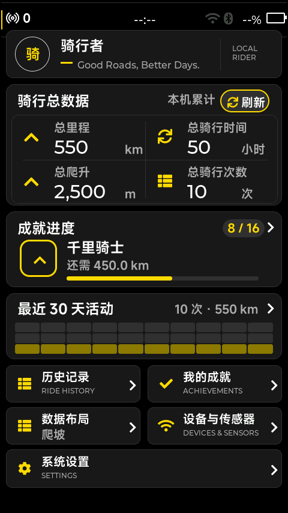

# 个人主页空间调整

本文件记录上一轮调整。随后用户明确要求性能信息作为半透明浮层，不占页面高度；
当前内容底边已改为 y=838，保留 16 px 产品边距。当前规范及新版预览见
[全局底部与对齐规范](全局底部与对齐规范_20261002.md)。下表与配图保留为上一轮记录。

| 区域 | 调整前高度 | 调整后高度 |
| --- | ---: | ---: |
| 身份卡 | 74 | 80 |
| 骑行总数据 | 184 | 202 |
| 成就进度 | 122 | 126 |
| 最近 30 天活动 | 103 | 110 |
| 两列功能入口 | 58 | 62 |
| 系统设置 | 58 | 64 |

主要卡片之间统一留 10 px，底部入口两行之间留 8 px，增大统计两行的垂直空间并维持数值和单位的基线对齐。
活动格子由实际卡片宽度均分，保留 2 px 分隔，格子高度从 12 增至 16 px。
刷新按钮增加到 38 px 高，入口图标、标题、副标题和箭头按新的卡片高度重新定位。

保持已有数据来源、操作入口、黑灰黄色主题、编码器焦点与按压动效。
构建成功，CTest 33/33 通过，检查了空记录、有记录和成就全部完成的真实 LVGL 渲染。
预览使用独立测试数据，未写入用户骑行记录；预览测试关闭性能浮层以便检查布局，正常运行仍显示性能信息。

