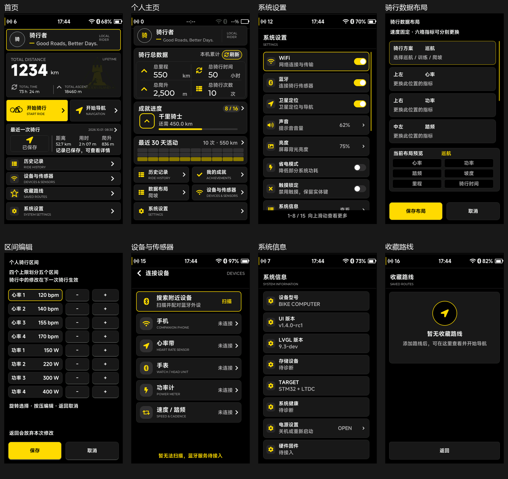
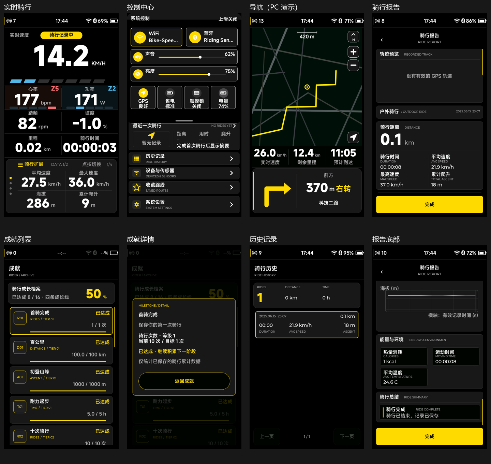

# 全局底部与对齐规范

本轮按最终产品 UI 确定布局。FPS、CPU 与耗时信息属于诊断浮层，不分配底部专用空间。
以下坐标均为内部 480×854 画布；电脑窗口缩放不改变这些坐标。

| 项目 | 当前规则 |
| --- | --- |
| 产品底边距 | 16 px |
| 固定内容底边 | y=838，坐标不含该边界 |
| 底部保存、取消、返回、完成及分页按钮 | 72 px 高，普通全屏页从 y=766 开始 |
| 设置范围提示、设备反馈 | 28 px 的末行槽位，位于 y=810 |
| 底部交互容器 | 保留 156 / 226 / 442 px 三种展开高度，共用 16 px 底边距 |
| 性能信息 | 系统最上层，黑色背景 30% 不透明度，文字保持可读；不参与产品布局 |

首页、个人主页、骑行扩展卡、导航底卡、设置、系统信息、设备连接、收藏路线、
成就列表、历史记录、骑行报告与两类编辑器均采用共同的产品底边界。
浮动成就详情在屏幕居中，返回按钮同样为 72 px；小型加减、播放控件按自己的用途保留尺寸。
页面的内容结构不同，内部卡片不强制采用同一高度。

## 对齐处理

- 共用按钮标题按实际字体高度水平、垂直居中；不再用预计字高计算 y 坐标。
- 双行入口按“标题 + 副标题”整体垂直居中，正文保持左对齐。
- 图标在自己的槽位居中，行内图标、状态、箭头及开关共享垂直中心。
- 双行组件中每个标题字段保持一行，超长内容以省略号收尾；切换字体时自动更新行高。
- 骑行指标的标题与读数组合在可用区域内居中，数字与单位继续底部对齐。
- 个人主页重新分配卡片空间，系统设置入口结束于 y=838；总体数据、活动矩阵和真实数据绑定保留。
- 数据布局编辑器扩大列表及预览格，右侧滚动条、固定保存与取消按钮保留。

## 交互检查

骑行报告的完成按钮固定在底部，滚动内容与其保持 12 px 间距；编码器滚动上限改为
实际视口高度，保证报告最后的保存状态可以完整查看。电源页取消按钮移入底部，
仍保留在编码器选择顺序中，支持触摸及编码器确认。

黑色、灰色与黄色主题、现有胶囊展开及按压动画、减少动态效果策略、PRTS 开机源文件、
真实历史与硬件接入接口保留。电脑缩放继续支持 F1 约 3 英寸、F2 50%、F3 原始尺寸；
物理大小需以尺子校准，详见 [模拟器尺寸与校准](模拟器尺寸与校准_20261002.md)。

## 验证与实际预览

2026-10-02：CMake/Ninja 构建成功，CTest 33/33 通过。回归覆盖字体变化与焦点边框下的居中、
固定完成按钮、报告末尾滚动、取消操作、触摸与编码器、保存反馈和模拟器缩放。
225 组整屏与分块刷新帧逐像素一致；6 个 PRTS 开机源文件的哈希保持不变。

预览来自真实 LVGL 渲染。统计数字为独立测试数据，未写入用户骑行记录；
截图关闭诊断浮层以便检查产品布局。正常模拟器运行仍显示性能信息。
PC 渲染检查无法证明 MCU 的实际帧率，真机显示驱动接入后仍需测量。

验证记录：[validation.json](previews/global-alignment/validation.json)。
