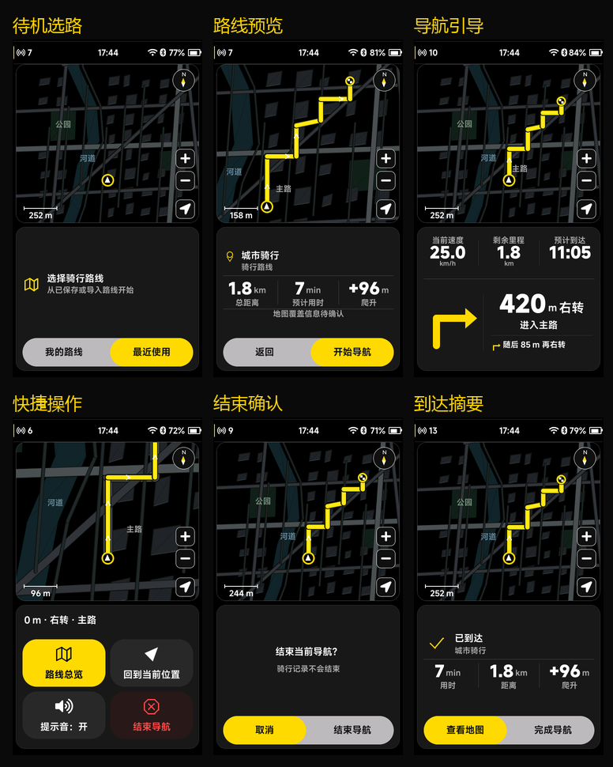

# 导航固定卡片与胶囊选择

> 后续规则更新（2026-10-04）：当前“结束导航/完成导航”统一结束并保存骑行。下文旧结束规则属于该轮记录，当前行为以 [设置设备大卡片与导航结束保存_20261004.md](设置设备大卡片与导航结束保存_20261004.md) 为准。

后续尺寸已统一到骑行页常规交互坞，最新规则与实际预览见 [导航统一交互坞](导航统一交互坞_20261003.md)。本文保留上一轮的实现记录。

本轮根据用户最新要求调整导航 UI。本文的固定几何与输入规则替代初始 v2.1 中按状态改变坞高度的规则；导航数据、异步确认和硬件服务契约沿用 v2.1。

## 布局与外观

480×854 内部画布保持不变。状态栏下方的地图和交互坞各自放在圆角卡片中：

| 区域 | 位置与尺寸 |
| --- | --- |
| 地图卡片 | x=8、y=62，464×402 px |
| 卡片间隔 | 10 px |
| 交互坞卡片 | x=8、y=474，464×364 px |
| 产品底边距 | 16 px；性能信息仍覆盖在最上层 |

待机、准备、预览、引导、快捷操作、结束确认和到达使用同一套固定卡片尺寸。切换内容不改变地图边框，也不重新创建地图对象。独立路线内容页、离线地图等辅助页面仍使用原来的完整页面布局。

“我的路线／最近使用”“返回／开始导航”“取消／结束导航”“查看地图／完成导航”等双选项采用浅灰长条底座、深色文字和实心黄色胶囊。胶囊前后缘采用不同的阻尼响应，切换时拉伸、回弹，快速反向时保留当前运动；文字不跟随胶囊变形。进入卡片后隐藏外层黄色焦点框，避免与选项强调重复。

地图比例尺固定在左下角，缩放与回中固定在右侧下部。当前位置在固定地图区域内跟随显示，路口相机继续使用有效路口／出口坐标。所有导航状态的地图边界和坞边界保持一致。

## 编码器、触摸和返回键

1. 进入导航页时处于外层卡片选择。旋转编码器在地图／交互坞之间切换，按下进入所选卡片；单纯选卡片不会缩放或执行按钮。
2. 进入地图后，旋转选择方向、放大、缩小和回中，按下执行当前控件。触摸地图仍可浏览，触摸控件仍可直接操作。
3. 进入交互坞后，旋转切换按钮，按下确认。在没有操作按钮的实时引导状态，旋转返回地图卡片选择，按下打开快捷操作。总览中的“返回跟随”也可用编码器确认。
4. 导航中按硬件返回键，或模拟器鼠标右键，打开包含路线总览、回到当前位置、提示音和结束导航的快捷坞；该操作不会离开导航页或停止导航。
5. 选择“结束导航”后仍需确认。返回取消确认并恢复之前的快捷操作焦点；在快捷坞再次返回则恢复引导及外层卡片选择。
6. 未开始导航时，在地图控件或待机坞内返回先退出当前卡片的控制，再次返回才离开页面。路线准备／预览和资源辅助页沿用对应的取消／返回流程。
7. 上滑／下滑仍可切换快捷坞与引导；手势只让坞内内容轻微随动并切换内容，不再改变两张卡片的尺寸。

开始导航继续等待后端 ACK；结束导航不结束骑行记录；离页保留有效导航会话。

## 数据和生产接入边界

产品画面删除演示地图说明和演示／示意名称，PC 数据使用中性的路线、道路与区域名称。仅凭这项视觉调整不能把合成地图变为真实西安地图。

`demo` 来源字段和 PC 适配器中的合成数据标识仍然保留。实际固件必须接入硬件导航服务和真实地图窗口，不能把 PC 适配器作为正式地图／规划服务。真实数据接口、能力位、坐标系统、取消和旧数据拒绝机制见 `NAVIGATION_UI_V2_1.md`。

## 验收

- CMake/Ninja 构建成功，CTest 35/35 通过。
- 27 个导航状态和动效中间帧的全帧／局部刷新结果逐像素一致，包含胶囊拉伸与快速反向。
- 新增实际按钮位置／行高／边界、标题与统计间距、卡片切换不误缩放、进入控件后执行、返回快捷坞以及总览编码器确认检查。
- 保留 120 次菜单打断／反转回放的堆、定时器与动画稳定性检查。
- PRTS／开机／HOME／Profile 的 8 个受保护源文件 SHA-256 保持一致。

验证记录：`previews/navigation-cards/validation.json`。本轮不改工程版本、不提交或推送 Git；PC 验证不代表 STM32 真机帧率或真实道路导航验收。
