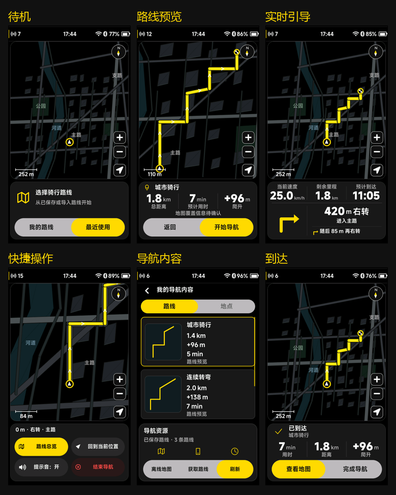

# 导航统一交互坞

> 后续规则更新（2026-10-04）：当前“结束导航/完成导航”统一结束并保存骑行。下文旧结束规则属于该轮记录，当前行为以 [设置设备大卡片与导航结束保存_20261004.md](设置设备大卡片与导航结束保存_20261004.md) 为准。

本轮以骑行页正常交互坞为尺寸基准。本文替代《导航固定卡片与胶囊选择》中 364 px 坞高和 402 px 地图高度；导航数据契约、开始确认和返回优先级继续沿用。

## 固定几何

内部画布保持 480×854。

| 区域 | 位置 | 尺寸 |
| --- | --- | --- |
| 地图卡片 | x=8、y=62 | 464×540 px |
| 卡片间距 | y=602～611 | 10 px |
| 导航交互坞 | x=8、y=612 | 464×226 px |
| 辅助页资源操作卡片 | x=8、y=612 | 464×226 px |
| 底部操作行 | 坞内 y=142 | 432×72 px |
| 产品底边距 | y=838～853 | 16 px |

坞高直接引用 `UI_BOTTOM_SURFACE_NORMAL_HEIGHT`，避免骑行和导航维护不同常量。待机、目的地确认、准备、预览、实时引导、总览、快捷操作、结束确认、错误和到达切换时不改变两张卡片的尺寸，也不重建地图对象。右下角性能信息继续作为顶层浮层，不占用布局高度。

实时引导在同一张卡片中容纳三列骑行数据，以及当前转向、道路和有效的下一步指令。转向图标依据区域大小绘制，文字单独排版，不整体缩放卡片。快捷操作改为两行四个 210×72 px 按钮，保留总览、回中、提示音和结束导航。

“我的导航内容”列表结束于底部卡片上方；离线地图、版本记录和存储页面也采用相同底部卡片。列表通过滚动浏览，不让条目从底部按钮后面露出。系统告警和控制中心独立的迷你／展开预设未纳入导航尺寸替换。

## 胶囊按钮

“离线地图／获取路线／刷新（下一页）”改为浅灰长条底座和黄色实心选择胶囊，按钮文字固定且居中。离线地图中的版本／空间、返回／更新、其他资源页的刷新，以及内容页路线／地点分段也使用同一个胶囊组件。

前后缘采用不同响应速度的阻尼弹簧，移动时拉伸并回弹，快速反向保持运动连续。胶囊边缘限制在底座范围内；文字和触摸区域不随填充变形。禁用按钮降低透明度，不能执行，也不会被黄色胶囊标为可用。减少动态效果模式直接落到最终位置。

路线列表焦点和工具栏焦点独立保存。刷新目录、分页或异步结果更新不会把“刷新”焦点变成第一条路线。工具栏保留上次选择；路线／地点标签表示已应用的内容分类，按下确认后才切换数据。

## 输入与真实数据

- 导航主页：编码器旋转选择地图或交互坞，按下进入卡片，再旋转选择控件、按下执行。
- 路线内容与资源页：旋转依次选择条目和资源操作，按下执行；触摸直接操作按钮。
- 正在导航：硬件返回键／模拟器右键打开快捷坞；结束仍需确认。上滑／下滑切换引导和快捷内容，卡片尺寸不变。
- 页面跳转不结束有效导航；结束导航不结束骑行记录；开始导航仍等待服务 ACK。

离线地图、手机连接、路线导入和刷新继续通过既有 `ui_nav_store` 请求与能力位。未接入服务显示实际不可用状态，地图文件缺失不显示“已安装”。PC 合成数据来源字段保留，正式固件通过真实地图窗口、GNSS 和导航服务接入。

## 验证

- CMake/Ninja 构建成功，CTest 35/35 通过。
- 30 组导航状态和胶囊动效截图，全帧／局部刷新逐像素一致。
- 新增资源工具栏几何、液体胶囊中途反向与刷新焦点保持检查。
- 资源胶囊 30 次中途反向销毁，弹簧全部释放；减少动态效果与禁用状态检查通过。
- 原有 120 次菜单切换回放继续通过，预热后堆、定时器和动画数量稳定。
- 8 个 PRTS／开机／HOME／Profile 源文件 SHA-256 一致。

完整状态预览与验证记录位于 `docs/previews/navigation-dock-226/`。本轮未提交或推送 Git，版本号仍为已有基线。
