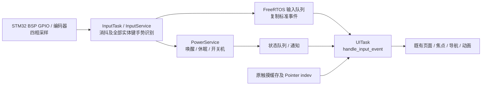

# LVGL 1.5.1 实体输入架构与 STM32 队列契约

> v1.5.2 归档说明：本文记录 2026-10-09 的开发阶段，标题中的 1.5.1 为当时版本；此输入契约纳入 v1.5.2。当前全流程入口见 [STM32 v1.5.2 接入说明](STM32_V1.5.2_INTEGRATION.md)。

本轮直接修改的最终工程为 `D:/Postgraduate_Program/111AAALearn_Lab/111AAABikeComputer/Software/Lvgl_Project`。只调整实体按键/编码器的事件来源与边界，复用现有页面、焦点、导航、异步命令和动画。版本仍为 1.5.1。本轮没有修改 STM32_Project 的 BSP、HAL、FreeRTOS 或 InputService 实现。

2026-10-09 的用户决定替代 2026-10-06 Board-Ready 文档中“InputTask 采样，UI 识别实体按键”的输入契约。旧文档、旧 CSV 是当时的源码快照；涉及实体输入时以本文和当前源码为准。存储、导航、触摸、字体、显示等其余端口契约保持原有实现。

## 1. 唯一的数据流



InputTask 不调用 UI 的事件处理入口、页面函数或 LVGL。UiTask 接收记录后调用 `ui_stm32_services_handle_input_event()`，立即映射到 `ui_app_handle_input()` 的原有动作，不再进入第二个 UI 输入队列。该入口会通过 `ui_runtime_require_ui()` 拒绝 worker 和 ISR，并要求 `ui_app_init()` 已完成。

PC SDL event watch 只复制记录到现有 `ui_input_queue`。20 ms UiTask 定时回调取出 `UI_INPUT_PHYSICAL_EVENT` 后走同一个 `ui_app_handle_input_event()`。这保持 SDL event watch 与 LVGL 的线程边界，并与原触摸队列共用顺序和溢出诊断。

## 2. 公共 C 接口

平台无关数据头文件：`src/ui/core/ui_physical_input.h`。其中没有 HAL、FreeRTOS、SDL 或 LVGL 头文件。`ui_input_event_t` 仍是原有“页面动作”枚举，不能与物理事件结构混用。

```c
typedef enum {
    UI_PHYSICAL_KEY_NONE = 0,
    UI_PHYSICAL_KEY_POWER = 1,
    UI_PHYSICAL_KEY_BACK = 2,
    UI_PHYSICAL_KEY_PREV = 3,
    UI_PHYSICAL_KEY_NEXT = 4,
    UI_PHYSICAL_KEY_MENU = 5,
    UI_PHYSICAL_KEY_ENCODER_BUTTON = 6,
    UI_PHYSICAL_KEY_ENCODER = 7,
    UI_PHYSICAL_KEY_COUNT
} ui_physical_key_t;

typedef enum {
    UI_PHYSICAL_ACTION_NONE = 0,
    UI_PHYSICAL_KEY_DOWN = 1,
    UI_PHYSICAL_KEY_UP = 2,
    UI_PHYSICAL_KEY_CLICK = 3,
    UI_PHYSICAL_KEY_DOUBLE_CLICK = 4,
    UI_PHYSICAL_KEY_LONG_START = 5,
    UI_PHYSICAL_KEY_LONG_REPEAT = 6,
    UI_PHYSICAL_KEY_LONG_END = 7,
    UI_PHYSICAL_ENCODER_DELTA = 8,
    UI_PHYSICAL_ACTION_COUNT
} ui_physical_action_t;

#define UI_PHYSICAL_ENCODER_MAX_DELTA 64

typedef struct {
    uint8_t key;
    uint8_t action;
    uint16_t reserved;
    int32_t encoder_delta;
    uint32_t timestamp_ms;
} ui_physical_input_event_t;

/* src/platform/stm32/ui_stm32_services.h；均由 UiTask 调用 */
bool ui_stm32_services_handle_input_event(
    const ui_physical_input_event_t *event);
bool ui_stm32_services_apply_display_state(bool enabled);
```

结构大小 12 字节，`encoder_delta` 偏移 4，`timestamp_ms` 偏移 8；源码有 C11 静态断言，key/action 用固定宽度字段避免 AC6 short-enum 选项改变队列布局。它是进程内队列记录，不能直接当作 ESP32 串口网络协议包发送。

`reserved` 必须为 0；非编码器事件的 `encoder_delta` 必须为 0。编码器事件固定 `key=UI_PHYSICAL_KEY_ENCODER`、`action=UI_PHYSICAL_ENCODER_DELTA`，正数为 CW，负数为 CCW，0 是无动作。方向与原 UI 动作一致；板端在 InputService 中归一化，不在 UI 中做四相解码或倍率换算。

一个事件可含 -64..64 档，UI 按实际档数调用既有动作，不累计四个跳变才触发，也不静默裁剪。超出上限返回 false 且增加 `UI_DIAG_INPUT_INVALID`，不会部分执行；InputService 应拆成多个记录。这是单次 UI 调用的执行预算，区别于原来 ±64 pending 裁剪、每次采样最多发 4 档的识别逻辑。

`timestamp_ms` 使用与 ride/nav/quality 相同的板端单调毫秒时钟，保持队列 FIFO 顺序。PC 队列复制并保留时间戳；UI 映射函数不据此判断 click/double/long，也不排除零值、回绕或数值逆序。队列积压/事件年龄应由系统诊断，不能把跨回绕的普通数值比较当作时间排序。

返回 true 表示合法事件已被消费；POWER、生命周期及未定义产品行为的组合可能没有页面动作，启动动画/安全流程也可能按原规则挡住动作。它不代表硬件命令成功。返回 false 表示非法数据、未初始化或错误线程；调用方应记录失败，不要盲目重试已经被消费的事件。

## 3. 保持原交互的映射

| 物理键 | 已识别 action | 既有 UI 动作 / 结果 |
| --- | --- | --- |
| BACK | KEY_CLICK | UI_INPUT_BACK：原返回、关闭编辑器/菜单/坞、取消结束确认 |
| BACK | KEY_DOUBLE_CLICK | UI_INPUT_BACK_DOUBLE：骑行中暂停、暂停中恢复 |
| BACK | KEY_LONG_START | UI_INPUT_BACK_LONG：骑行/暂停中进入原结束确认 |
| PREV / NEXT | KEY_CLICK | UI_INPUT_PAGE_PREV / NEXT：原分页和导航上下文 |
| MENU | KEY_CLICK | UI_INPUT_TOGGLE_CONTROL_CENTER：原控制中心 / 导航菜单 |
| MENU | KEY_LONG_START | UI_INPUT_RIDE_TOGGLE：原骑行开始、GO、暂停/恢复 |
| ENCODER_BUTTON | KEY_CLICK | UI_INPUT_ENCODER_PRESS：原焦点确认、菜单、音乐/地图上下文 |
| ENCODER_BUTTON | KEY_LONG_START | UI_INPUT_TOGGLE_CONTROL_CENTER：保留原长按映射 |
| ENCODER | ENCODER_DELTA | 按符号/档数执行原 CW / CCW：焦点、调节、地图缩放 |
| POWER | 全部键事件 | 合法消费，无 LVGL 动作和电源命令；由 PowerService 处理 |
| 所有按键 | DOWN / UP / LONG_REPEAT / LONG_END | 合法消费，无第二次 click 或长按动作 |
| PREV / NEXT | LONG_START | 无动作，原实现也没有对应长按行为 |
| BACK 以外的键 | DOUBLE_CLICK | 无动作，不降级成额外 CLICK；原产品未定义双击动作 |

MENU 原名为 `UI_HW_KEY_RIDE` / `UI_HW_KEY_MENU`，以当时 `ui_stm32_services_register()` 覆盖后的有效映射为依据，不使用旧硬件输入模块的默认映射。

所有 UI 行为仍受原上下文优先级控制：编辑器、结束确认、控制中心、动态坞、安全状态、导航工作区等没有新增第二套处理器。触摸按钮继续调用原 action 和异步服务，实体键最终也到达这些动作。

## 4. InputService 必须保证的互斥规则

按键识别只在 STM32 系统层实现。建议沿用原产品参数作为初始值：消抖 25 ms、长按 1200 ms、BACK 双击窗口 280 ms；这些数值现在没有任何 UI 侧实体识别代码。最终采样周期、重复间隔和参数配置仍属于 InputService，UI 不限制它们。

同一手势只能生成一个 CLICK、DOUBLE_CLICK 或 LONG_START 结果。BACK 第一次释放后需要等待双击窗口才确认单击；第二次点击成立时取消待发单击并仅发 DOUBLE_CLICK。长按成立时取消本次 click 候选，只发一次 LONG_START，后续可发 LONG_REPEAT，释放发 LONG_END/UP，不补发 CLICK。如果同一窗口中“第一次短按、第二次长按”存在歧义，应按系统层明确的长按优先策略处理，不能一边提前发 CLICK 一边又发长按。

UI 没有“补救上游重复事件”的状态机：若 InputService 错误地同时发送 CLICK 和 DOUBLE_CLICK，UI 会按两个独立事件执行。验收的“不重复”依赖这条生产者契约，不能通过在 UI 再加入双击计时来弥补。

输入队列满时必须有溢出计数和故障处理；生命周期记录丢失、编码器档位丢失、PowerService 通知丢失不能静默忽略。可以在 InputService 合并相邻编码器增量后按上限拆分，但不得跨过 click/long/power 事件改变顺序。未确认的 STM32 队列策略本轮没有修改。

## 5. 与当前 STM32 工程对齐

已核对 `Software/STM32_Project/App/Common/app_events.h`，当前为：

```c
typedef struct {
    AppInputType_t type;
    int32_t value;
} AppInputEvent_t;
```

其 type 只有 POWER/MENU/PREV/NEXT/BACK 和 ENCODER_CW/CCW/PRESS，无法表达 double/long/repeat/end/timestamp，不能直接作为新事件使用。原枚举编号与新 key 编号也不同，禁止直接 cast。

推荐下一轮在 STM32 的公共事件头中引用 UI 平台无关头并使用同一记录：

```c
#include "ui/core/ui_physical_input.h"
typedef ui_physical_input_event_t AppInputEvent_t;
```

如系统需要独立名称，可保留系统结构并增加相同语义字段，用显式 switch 转换 key/action；桥接层只复制字段，不做消抖和手势判断。保留当前 type/value 结构再由 UI 推断手势不可行。

当前 `App/RTOS/app_rtos.c` 输入队列长度为 16，静态 storage 和 `xQueueCreateStatic()` 均使用 `sizeof(AppInputEvent_t)`。升级 typedef 后尺寸会跟随，但必须整体重新编译所有生产者/消费者；不能混用旧 payload，不能在运行中保留旧队列对象。12 字节记录的 16 槽 storage 为 192 字节，不含 FreeRTOS StaticQueue_t。

下列是后续 STM32 接入方式示意，不是本轮新增驱动：

```c
/* InputTask：BSP采样 -> InputService完成识别后 */
AppInputEvent_t event = {
    .key = UI_PHYSICAL_KEY_BACK,
    .action = UI_PHYSICAL_KEY_DOUBLE_CLICK,
    .timestamp_ms = board_now_ms()
};
/* 用现有队列函数；返回失败必须计数。InputTask不调用LVGL。 */
if (!App_RTOS_PostInputEvent(&event, 0)) {
    input_queue_drop_count++;
}

/* UITask：ui_stm32_startup/ui_app_init完成后；每轮限制消费量。 */
AppInputEvent_t event;
for (unsigned n = 0; n < 16; ++n) {
    if (!App_RTOS_GetInputEvent(&event, 0)) break;
    if (!ui_stm32_services_handle_input_event(&event)) {
        ui_input_rejected_count++;
    }
}
ui_stm32_ui_task_handler();
```

ISR 只使用 FromISR queue/notification 唤醒 InputTask；不能在 ISR 中使用以上任务 API、识别整套手势或调用 UI。UiTask 不等待 InputService、不调用 HAL_Delay、FatFs、HTTP。原骑行与设备操作仍通过现有异步 command/complete 闭环。

## 6. POWER 与触摸边界

POWER 的实体 long/click 不映射 `UI_INPUT_OPEN_POWER` 或 `UI_INPUT_POWER_TOGGLE`。PowerService 负责真实电源、显示硬件、系统休眠/唤醒与活动策略，不能依赖 LVGL 长按事件。PowerService 完成显示状态变化后，通过系统状态队列/通知让 UiTask 调用：

```c
/* UITask；只是复用原黑屏覆盖层的显示反馈，不执行硬件操作。 */
ui_stm32_services_apply_display_state(display_enabled);
```

这不是工作任务可直接调用的 mailbox，也不代替既有 UI 命令的完成 ACK。触摸电源菜单、PC 的 o/p 系统开发快捷键、既有 UI 空闲息屏策略及异步确认流程保持原行为；它们仍可向正式 PowerService backend 提交请求。实体 POWER 不通过这些快捷动作再发一份命令。系统层应统一仲裁这些请求与实际电源状态；本轮没有实现关机硬件或改变原空闲策略。

触摸仍沿用 `ui_stm32_services_submit_touch()` 的校准缓存、BEGIN/MOVE/END/CANCEL 事件和唯一 LVGL POINTER indev。没有改动触摸识别、Scroll Snap、拖拽、地图长按、LV_EVENT_CLICKED/LONG_PRESSED，也没有手工再触发一次触摸按钮 action。STM32 与 PC 都没有创建实体键 keypad/encoder indev，因此物理事件只有语义接口一条 UI 行为路径。

## 7. PC 模拟器操作

| PC 操作 | 注入的语义事件 |
| --- | --- |
| Esc / Backspace / 鼠标右键一次 | BACK + CLICK；不等待双击窗口 |
| F5 | BACK + DOUBLE_CLICK；不先发 CLICK |
| F6 按下 / 系统重复 / 释放 | BACK + LONG_START / LONG_REPEAT / LONG_END；不按持有时间判断 |
| F7 按下 / 系统重复 / 释放 | MENU + LONG_START / LONG_REPEAT / LONG_END |
| F8 按下 / 系统重复 / 释放 | ENCODER_BUTTON + LONG_START / LONG_REPEAT / LONG_END |
| m | MENU + CLICK |
| Enter / 小键盘 Enter | ENCODER_BUTTON + CLICK |
| Left / Right | PREV / NEXT + CLICK |
| Down / Up，包括系统重复 | ENCODER_DELTA +1 / -1 |
| 滚轮向下 / 向上 | 正 / 负档数，保留事件幅度；大批次拆分 |

F1/F2/F3 的窗口比例模式、+/− 校准、o/p 系统开发快捷键、[ / ] 个人主页/设置、n 导航演示、s 静止模拟仍保留。鼠标左键继续完整模拟触摸。

PC 现在模拟 InputService 的结果，不用真实“双击两次右键”识别双击，也不用按住 Esc 1.2 秒识别长按。两次右键会是两个独立 CLICK；需要双击语义请按 F5。这是本轮要求的输入来源改变，页面收到相同语义后的行为保持原样。

## 8. 旧接口迁移与验收资料

`ui_stm32_services_sample_inputs()`、`ui_stm32_services_set_key_map()`、`ui_stm32_services_submit_input()` 已从正式服务边界删除，没有保留会悄悄识别手势的兼容实现。旧的 generic submit_input 能让 worker 注入页面动作，故一并移除，实体输入只能由 UiTask 调用新入口；触摸继续使用专用 submit_touch。

`ui_hardware_input.c/.h`、`ui_back_key_gesture.c/.h` 及两个识别状态机测试已删除。新测试检查语义互斥映射、时间戳无关、正反/连续档位、非法数据、队列溢出、PC SDL 注入、真实 SDL HAL 的单路径与页面/骑行动作，以及 STM32 UiTask/worker/ISR 边界。集成回归的实体动作已改为生产语义入口，同时发送 DOWN/UP 和长按 REPEAT/END，防止释放附带 click。

最终修改文件、测试结果与证据见同目录 `输入架构重构验收_20261009.md` 和 `输入架构修改文件_20261009.csv`。原字体、页面源码、视觉资源、地图数据及 VERSION 保持本轮修改前内容；STM32 工程只读核对。
