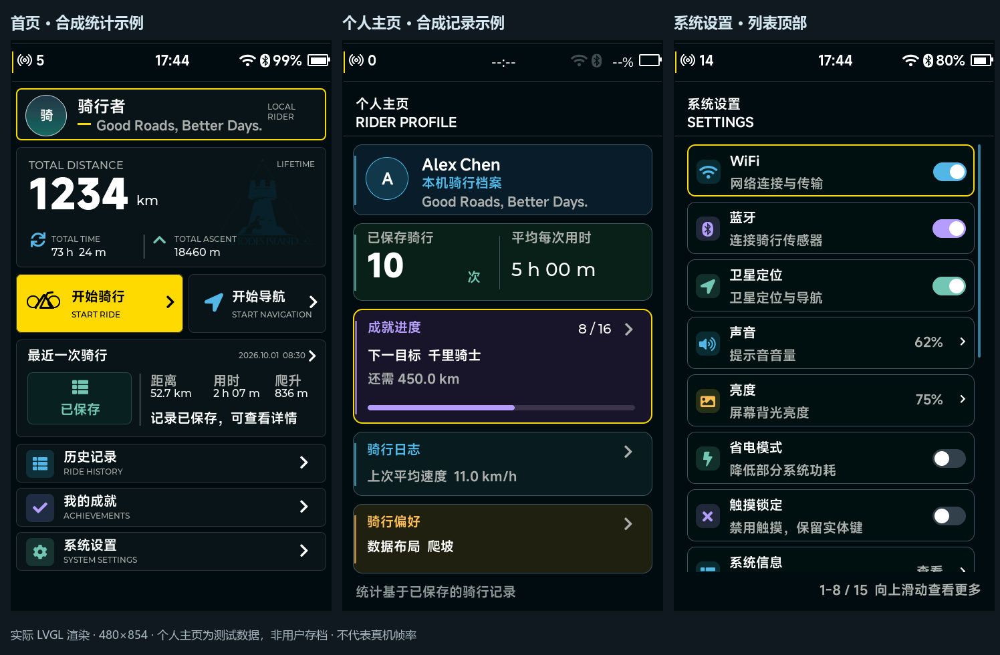

# 首页、个人主页与设置细化

本文为上一轮多色方案的实现记录。用户追加参考图后，当前工程已改为纯黑／中性灰／黄色主题，并重构个人主页；最新设计与预览见 [黑黄主题与个人主页重构](黑黄主题与个人主页重构_20261001.md)。以下旧预览保留用于对照，不代表当前配色。

日期：2026-10-01。适用工程：`D:/Postgraduate_Program/111AAALearn_Lab/111AAABikeComputer/Software/Lvgl_Project`。屏幕：480×854、3 英寸；输入：触摸、五键及可按压编码器。沿用已有 D 盘工具链，没有新增环境或依赖。

本轮在包含最新版 PRTS 启动动画的工程上修改原生 LVGL 页面。以下预览直接来自 RGB565 渲染缓冲；示例累计值和个人主页记录为合成测试数据，未写入用户的骑行存档。



## 判断与修改范围

原首页累计卡中的山形和道路线条没有数据含义；最近骑行还展示固定路线图形。个人页固定的等级和活跃标签不能由已存数据验证，并重复首页累计距离、用时、爬升。设置页隐藏滚动条、行高偏小、说明文字过小，未向用户说明还有多少内容。

本轮通过真实内容、清晰层级、功能色与操作反馈提升成熟度。增加颜色并不等于商用验收完成：日间可读性、戴手套热区、真实显示帧耗时和全局主题仍需后续验证。

## 首页

- 删除累计卡山形／道路装饰线，使用用户提供图标生成的 176×149 A8 蒙版水印，图像透明度 24/255、淡蓝着色。资源位于文字底层且不拦截触摸。
- 蒙版数据为 26,224 字节静态数组，不依赖运行时 PNG 解码或 PC 文件路径。源文件为 `src/ui/assets/ui_home_watermark.c/.h`。
- 采用深蓝黑画布与低亮度卡片；历史、成就、设置入口分别使用蓝、紫、青绿。开始骑行和当前焦点继续使用黄色。
- 累计距离字号随位数调整，单位根据实际文字宽度跟随数值；累计及最近摘要数值优先保持 16 px，长值降至 14/12 px，仍超宽时显示省略并由详情提供完整内容。
- 姓名首字符形成头像；长姓名／签名显示省略，默认签名完整显示。累计卡的 `LIFETIME` 不再带暗示可以点击的箭头。
- 固定假路线图替换为骑行日志摘要标记，显示“已保存”或“暂无记录”。无记录时三个摘要均为 `--`；已保存但缺少距离或爬升时，对应字段也显示 `--`。

原状态栏、开机接管输入及首页八组错峰入场保留；没有替换启动演出或重设其时间线。

## 个人主页

| 信息区 | 内容与数据来源 |
| --- | --- |
| 身份 | 配置中的姓名、签名与首字头像；明确为“本机骑行档案”，不宣称已有云账号或会员等级 |
| 骑行习惯 | 已保存骑行次数；平均每次用时＝终身累计活动秒数÷已保存次数，不计暂停时间 |
| 成就进度 | 共 16 项，统一读取 `ui_achievement_model`；展示已解锁数量、下一目标、剩余量与真实进度条 |
| 骑行日志 | 最近保存记录的平均速度；字段质量未知的旧记录保留兼容，质量已知但无速度时明确不可用 |
| 骑行偏好 | 当前已配置的数据布局：巡航／训练／爬坡／自定义 |

累计距离、总用时和累计爬升继续由首页展示，个人页不再重复。成就／日志／偏好三个卡片分别打开成就页、历史页、设置页，支持整卡触摸、编码器选择／确认及统一返回。

“下一目标”选择未解锁项中完成比例最高者；比例相同按目录顺序选择。这是界面推荐规则，不是运动能力分级。全部解锁后显示完成态。无记录时平均用时为 `--`；不足一分钟显示秒。只有终身累计量、暂时没有可读详情缓存时显示“暂无可读详情，累计统计保留”，不会误称首次骑行。

各信息区采用蓝、青绿、紫、琥珀的低亮度底色，主数值维持白色；编码器焦点为黄色边框，按压动效沿用可打断的现有按钮通道。

## 系统设置

- 列表在 x20、y156，尺寸 440×640；每行高 78 px、间距 8 px。右侧预留独立空间，蓝色 4 px 滚动条仅在内容溢出时显示，静止也能看见当前位置。
- 底部显示当前可见行范围、总行数及操作提示，例如“1-8 / 15 向上滑动查看更多”；到末尾显示“已到底部，可向下滑动”。范围包括部分可见行。
- 去除颗粒背景，与首页／个人页统一深蓝黑画布；设置功能使用彩色图标和低透明度图标底色，正常边框弱化，黄色只表示当前焦点或待确认。
- 辅助说明改为 20 px 中文，解释触摸锁定、自动暂停、息屏继续记录等真实行为；动作值统一为“查看／打开／编辑”等中文。
- 开关颜色表达确认后的启用状态，球体沿现有弹簧通道移动；用户点击、命令等待、成功 ACK、失败继续沿用真实状态闭环，不以动画代替硬件结果。减少动效设置仍有效。
- 配置存储是只读状态行，取消点击和箭头，不制造无效操作。编码器可以滚到该行读取状态，确认不触发命令。
- 字体生成同步收集实际界面使用的中文标点／全角字符，修复说明中的顿号被安全回退为问号的问题。

78 px 约为 6 mm（依据 3 英寸有效对角线估算），比原先更易触摸，但不宣称已通过手套／雨水／骑行振动验收。硬件条件确定后仍需实屏检查；五键和编码器操作路径继续保留。

## 真实数据接入

生产任务继续提交真实骑行快照、字段质量及命令 ACK，禁止直接从传感器任务操作 label。历史保存成功后，应用会刷新首页、个人统计和成就；保存失败或未保存会话不计入终身累计。

新增 `ui_home_data_t` 字段：

```c
bool last_ride_available;      /* 是否存在可读的最近保存记录 */
bool last_distance_available;  /* 距离聚合是否可用 */
bool last_ascent_available;    /* 爬升聚合是否可用 */
```

正常后端接入无需手工修改首页模型：`ui_app.c` 从最近已保存历史的 `metric_flags` 推导这些标志。若项目另有直接更新首页模型的调用方，需要明确填充上述标志；合法零值与不可用数据分别显示 `0` 与 `--`。这是源级模型扩展，不修改 BKPF 配置或历史文件格式。

个人布局通过 `app_apply_preferences()` 调用 `ui_profile_page_set_preset()` 更新；姓名与签名继续使用已有配置接口，没有新增硬件依赖。

## 验证与预览

现有工具链增量构建成功，CTest **32/32** 通过；最后完整测试耗时 7.04 秒。测试数量按 CTest 用例计算，本轮扩展已有用例，没有将内部断言算作新测试。

覆盖首页水印与装饰删除、正常／缺失字段／长数字、个人页空记录／部分成就／全部成就／累计与详情缓存分离、最大次数显示、设置滚动范围／到底部、触摸拖动不误改开关、编码器来回滚动，以及原开机／重启／打断／首页输入锁流程。缺字和内存分配失败日志会导致渲染测试失败，新增中文说明还检查未被文本清理替换为问号。

固定相同模拟输入下，**215 组 FULL/PARTIAL 渲染帧逐像素一致**，其中包含开机、开机淡出／首页入场和本轮新增页面。这只证明导出的场景与帧，不等于所有可能状态或 STM32 显示时序验证。测试注入一次关机命令失败的警告属于预期故障场景，最终测试通过。

- [首页示例](previews/shell/home_populated.png)、[首页空状态](previews/shell/home.png)、[首页字段不可用](previews/shell/home_unavailable.png)
- [个人主页示例](previews/shell/profile_populated.png)、[无记录](previews/shell/profile_empty.png)、[成就全部达成](previews/shell/profile_complete.png)
- [设置顶部](previews/shell/settings_top.png)、[设置中部](previews/shell/settings_middle.png)、[设置底部](previews/shell/settings_bottom.png)
- [逐帧验证证据](previews/shell/验证证据.json)

原始 PPM 帧及生成脚本位于 `D:/Postgraduate_Program/111AAALearn_Lab/111AAABike_SpeedView/work/home-profile-polish/`。预览首页采用直接注入视图模型的合成摘要，个人页采用 10 条每条 55 km、5 h、250 m 的合成保存记录；两者是独立测试场景，不是同一账户数据。

## 后续边界

本轮推进了原计划 C 阶段的首页、个人主页和设置组件。导航、骑行报告、错误／加载与首次使用流程的整体设计统一，昼夜主题、周目标／个人纪录及真实性能验收仍待继续。实际硬件 60 FPS 未测，本轮没有修改显示、触摸、存储或传感器驱动。

水印来自用户提供的罗德岛图标，用于当前项目实现与预览；若未来用于商业发行，应另行确认品牌素材授权或替换为自有品牌图标。
