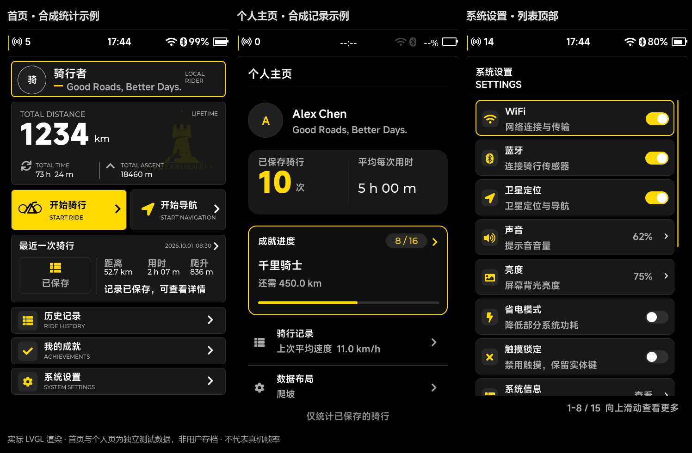

# 黑黄主题与个人主页重构

日期：2026-10-01。工程：`D:/Postgraduate_Program/111AAALearn_Lab/111AAABikeComputer/Software/Lvgl_Project`。本轮基于用户提供的三张 LOTUS.HMI 组件参考图，修改实际 LVGL 工程，沿用已有工具链和真实数据接口。

## 参考依据与设计判断

参考图片自身标注为“前期调研／组件”，是组件集合，不是经过验证的量产码表界面。本轮借鉴它的纯黑留白、中性灰胶囊、白色主信息、黄色强调和较少的装饰边框，没有复制汽车、耳机、品牌标志或不属于码表的功能。

用户认为上一版个人页有“AI 味道”，属于主观视觉反馈。可以具体定位的原因是五块同构彩色卡片、每块都带左侧装饰条、重复的中文与英文标题，以及每个信息区都争夺强调色。本轮通过改变布局层级、减少容器和收敛配色回应这一反馈，不把“换成黄色”单独视为完成设计。

## 配色

| 用途 | 规则 |
| --- | --- |
| 页面画布 | `#000000`，不使用深蓝或颗粒背景 |
| 常规表面 | 中性深灰 `#181818`，统计胶囊为 `#191919` |
| 主要文字 | 白色 |
| 次要文字／图标／边界 | 中性灰，通过字阶、位置与间距区分信息 |
| 产品强调 | 沿用黄色 `#FFD900`；主要操作、当前焦点、确认后的开关、成就进度 |
| 专用状态 | 骑行速度档位、心率／功率区间、暂停、错误继续保留实际含义对应的颜色与文字 |

深灰在 RGB565 中也会受通道量化影响。本轮实际渲染后把常规表面与头像底色调整为更接近中性的灰阶，没有用蓝／绿／紫来区分普通信息区。

全局背景默认 `UI_BACKGROUND_BITMAP_ENABLED=0`，不加载旧全屏 RAW 图片，页面根始终不透明黑色。旧背景资源注册、释放和显隐 API 保留，编译时明确启用位图主题才加载；真实数值、命令、存储与输入接口不受此选项影响。

## 个人主页

- 顶部只显示“个人主页”，去掉重复英文副标题。姓名、首字头像、签名直接位于黑底，移除身份卡及“本机骑行档案”装饰标签。
- 骑行次数与平均每次用时合并为一条灰色统计胶囊。次数作为黄色主数字，平均用时为白色次级数字；单位跟随实际文字宽度，不占据固定远端位置。
- 成就只保留一个主要模块：已解锁数量、最接近达成的成就名称、剩余量和黄色真实进度条。成就名称直接展示，不额外叠加“下一目标”标题。焦点到此处时显示黄色边框。
- 骑行记录和数据布局采用黑底轻量列表。普通状态为灰色图标／白色标题；编码器选中后出现灰色行背景、黄色侧标和箭头，没有多种彩色卡片。
- 底部以一行灰色文字说明统计只包含已保存骑行。

数据口径不变：平均每次用时＝终身累计活动秒数÷已保存次数；未保存会话不计入。成就共 16 项，最近未达成目标按完成比例选择；记录摘要读取最近保存记录的速度质量。无记录、缺失速度、累计统计与详情缓存分离、全部成就达成和长数值仍有明确状态。

触摸、编码器焦点、确认和统一返回保持可用；按压、开关、控制面板仍使用现有可打断动效，减少动态效果设置继续生效。没有改写另一轮已经完成的 PRTS 启动演出与首页八组入场时间线。

## 首页、设置与相关页面

首页卡片、头像和摘要标记收敛为中性灰，菜单与导航图标统一黄色；用户提供的水印仍位于累计卡底层，改为极低透明度黄色。数据和单位排版、真实空状态继续保留。

设置保留 78 px 行高、中文辅助说明、右侧 4 px 滚动条和底部范围／到末尾提示；图标和确认后的启用开关统一黄色，关闭开关为灰色。命令等待／失败继续由实际 ACK 驱动，静态换色不改变硬件动作。

成就档案与详情同步采用黑底、灰色表面和黄色进度，分类依靠名称与编号识别。共享控制中心与底部容器使用中性灰设计 Token，控制中心关闭状态图标不再使用蓝绿色底。

## 验证与预览

工程编译与测试结果、逐帧对照结果记录在 [验证证据](previews/black-yellow/验证证据.json)。本轮扩展原应用测试，明确检查首页／个人页／设置的黑色根背景与无位图，以及黄色滚动条；已有真实数据、成就、输入、动效、保存失败恢复与开机打断回归继续执行。

最终编译成功，CTest **32/32** 通过（6.82 秒）。相同模拟输入下 **215 组 FULL/PARTIAL 帧逐像素一致**；首页、个人页、设置和骑行页的画布采样均为 RGB(0,0,0)，三处常规表面采样为中性灰。开机前 50 张导出帧与上一轮逐字节一致。测试中的一次关机失败警告为预期故障注入，不代表正常运行失败。

- [首页](previews/black-yellow/home_populated.png)、[首页空状态](previews/black-yellow/home.png)
- [个人主页](previews/black-yellow/profile_populated.png)、[个人页空状态](previews/black-yellow/profile_empty.png)、[成就全达成](previews/black-yellow/profile_complete.png)
- [设置顶部](previews/black-yellow/settings_top.png)、[设置底部](previews/black-yellow/settings_bottom.png)
- [成就档案](previews/black-yellow/achievements.png)、[成就详情](previews/black-yellow/achievement_detail.png)、[控制中心](previews/black-yellow/expanded.png)

图片均为实际 480×854 RGB565 LVGL 输出。首页与个人页是独立合成数据场景，不是用户存档；没有写入或重置用户的骑行记录。原始帧与生成脚本位于 D 盘 `111AAABike_SpeedView/work/black-yellow-refine/`。

本轮未测真实 MCU 帧率、日间可读性或触摸误触率，也未实现昼夜主题。旧 [首页个人主页与设置细化](首页个人主页与设置细化_20261001.md) 中的多色设计和预览保留为上一轮记录；当前配色与排版以本文为准。
